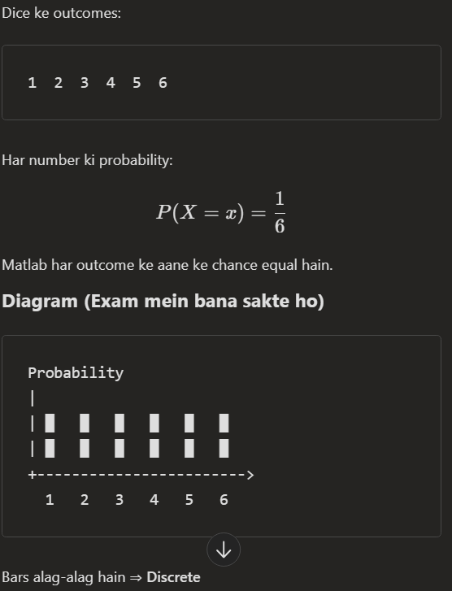
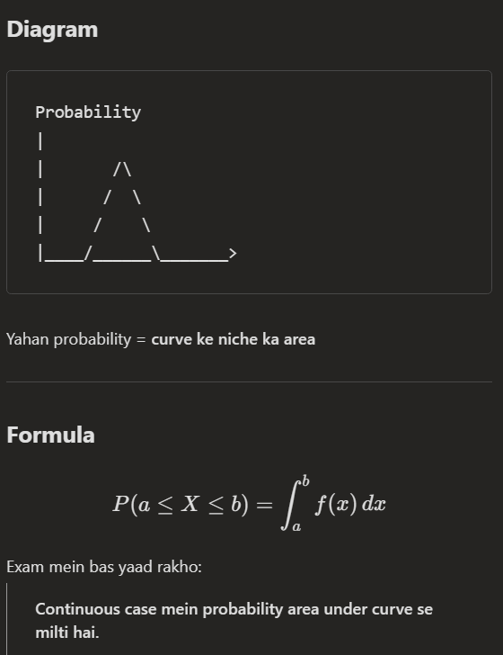
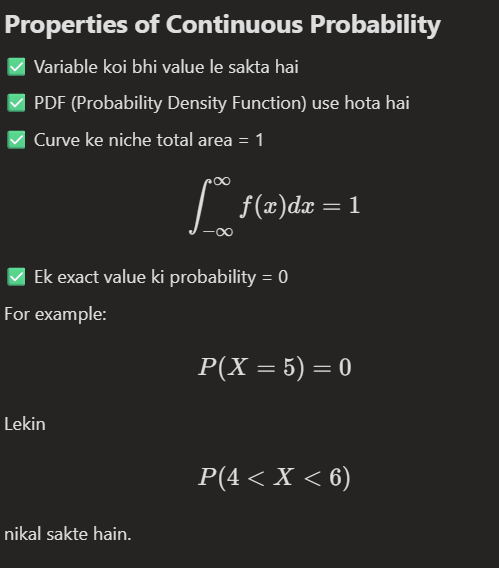

# **Module II – Probability Concepts in Simulation**

## **Topic 2: Discrete and Continuous Probability Functions**

### **1. Introduction**

In simulation, many things happen randomly. For example, the number of customers arriving at a bank or the time taken to serve a customer.

A **probability function** tells us how likely a particular value or range of values is to occur.

There are two main types:

1. Discrete Probability Function
2. Continuous Probability Function

## **2. Discrete Probability Function**

**Definition:** A discrete probability function tells us the probability of each possible value of a random variable.

It is used when a variable takes separate, countable values such as 0, 1, 2, 3, and so on.

**Example: Rolling a Dice 🎲**

When we roll a fair dice, the possible outcomes are 1, 2, 3, 4, 5 and 6.

The probability of getting any particular number is:

\\[ P(X=x)=\frac{1}{6} \\]

| Outcome (X) | Probability |
| ----------- | ----------- |
| 1           | 1/6         |
| 2           | 1/6         |
| 3           | 1/6         |
| 4           | 1/6         |
| 5           | 1/6         |
| 6           | 1/6         |

Here, each outcome has an equal probability.

**Important properties:**

- The variable takes countable values.
- Probability of each value is between 0 and 1.
- The sum of all probabilities is always 1.

\\[ \sum P(X=x)=1 \\]

**Other examples:**

- Number of customers arriving at a bank.
- Number of defective products in a box.
- Number of students absent from a class.

## **3. Continuous Probability Function**

**Definition:** A continuous probability function describes the probability of a continuous random variable taking values within a particular range.

It is used when a variable can take any value within a given range, including decimal values.

**Example: Waiting Time at a Bank 🏦**

Suppose a customer waits for service between 0 and 10 minutes.

The waiting time can be:

- 2 minutes
- 2.5 minutes
- 3.25 minutes
- 4.75 minutes

The exact waiting time can be any value within the range.

A continuous probability function is represented by a **Probability Density Function (PDF)**.

The probability of a variable falling within a range is calculated as the area under its probability density curve.

\\[ P(a\leq X\leq b)=\int_a^b f(x)\\,dx \\]

**Important properties:**

- The variable can take any value within a range.
- It is represented using a probability density function (PDF).
- The total area under the probability density curve is always 1.
- The probability of an exact single value is zero.

\\[ \int\_{-\infty}^{\infty} f(x)\\,dx=1 \\]

**Other examples:**

- Height of a person.
- Temperature of a room.
- Time taken to complete a task.
- Speed of a vehicle.

## **4. Difference Between Discrete and Continuous Probability Functions**

| Discrete Probability Function                 | Continuous Probability Function              |
| --------------------------------------------- | -------------------------------------------- |
| Deals with countable values.                  | Deals with values within a continuous range. |
| Uses a Probability Mass Function (PMF).       | Uses a Probability Density Function (PDF).   |
| Probability is assigned to individual values. | Probability is calculated over an interval.  |
| Sum of all probabilities is 1.                | Total area under the curve is 1.             |
| Example: Rolling a dice.                      | Example: Measuring waiting time.             |
| Exact values can have non-zero probability.   | Probability of one exact value is zero.      |

## **5. Simple Diagram to Remember**

**Discrete Probability – Separate values**

1

2

3

4

5

6

Each bar represents the probability of a separate outcome.

**Continuous Probability – Smooth curve**

The area under the curve represents probability.

## **6. Importance in Simulation**

- Helps represent random events in real-world systems.
- Helps generate random values for simulation.
- Used to model customer arrivals and service times.
- Helps analyse uncertain situations.
- Makes simulation results more realistic.

## **7. Quick Revision 📝**

| Remember         | Meaning                                   |
| ---------------- | ----------------------------------------- |
| Discrete         | Countable values                          |
| Continuous       | Any value within a range                  |
| PMF              | Probability of individual discrete values |
| PDF              | Probability density of continuous values  |
| Discrete total   | Sum of probabilities = 1                  |
| Continuous total | Area under curve = 1                      |

## **8. Important Exam Questions**

1. Define discrete probability function with an example.
2. Explain continuous probability function with an example.
3. Differentiate between discrete and continuous probability functions.
4. Explain PMF and PDF with suitable examples.

# **2-Mark Exam Answer**

#### Discrete Probability Function:
 A probability function that assigns probabilities to countable values of a random variable. Example: rolling a dice.

#### Continuous Probability Function:
 A probability function used for variables that can take any value within a range. Example: waiting time of a customer in a bank.

Super Shortcut Mnemonic

D = Discrete = Digits Countable
 C = Continuous = Continuous Range

Bas exam mein yaad rakho:

Count → Discrete (PMF)
 Measure → Continuous (PDF)

Exam tip

&#x20;For a 10–14 marks answer, write the definitions, explain both types with examples, include the comparison table and draw the two simple diagrams.

**Next topic:** Probability Distributions.

