# **Module II – Probability Concepts in Simulation**

## **Topic 5: Generation of Random Numbers**

### **1. What is Random Number Generation?**

**Random Number Generation (RNG)** is the process of producing numbers in an unpredictable order.

In simulation, random numbers are used to represent uncertain events such as customer arrivals, service times, machine failures and traffic conditions.

For example, when we simulate a bank queue, random numbers help decide when customers arrive and how much time they take for service.

### **2. Methods of Generating Random Numbers**

There are two common methods:

1. **True Random Number Generation**
2. **Pseudo-Random Number Generation**

### **A. True Random Number Generation (TRNG)**

True random numbers are generated using unpredictable physical events.

These numbers are not produced by a fixed mathematical formula.

**Examples:**

- Electronic noise
- Radioactive decay
- Atmospheric noise

**Characteristics:**

- Numbers are genuinely unpredictable.
- They are generated using physical processes.
- The same sequence cannot normally be reproduced.
- They may require special hardware.

### **B. Pseudo-Random Number Generation (PRNG)**

Pseudo-random numbers are generated using mathematical formulas or computer algorithms.

They appear random, but they are actually calculated using an initial value called a **seed**.

**Example:**

A computer can generate a sequence such as:

`12, 45, 78, 23, 91, 34`

These numbers appear random but are produced by a mathematical algorithm.

**Characteristics:**

- Generated using mathematical algorithms.
- Very fast and easy to generate.
- The same seed produces the same sequence.
- Widely used in computer simulations.

### **3. Linear Congruential Method (LCM)**

One common method of generating pseudo-random numbers is the **Linear Congruential Method**.

It generates a sequence of numbers using a mathematical formula.

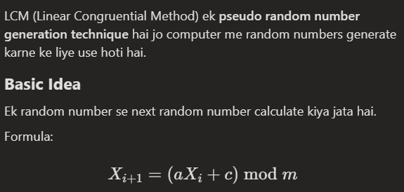

Where:

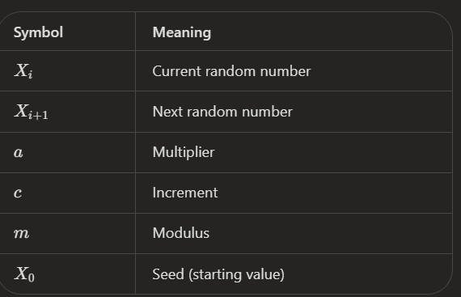

The generated number can be converted into a value between 0 and 1:

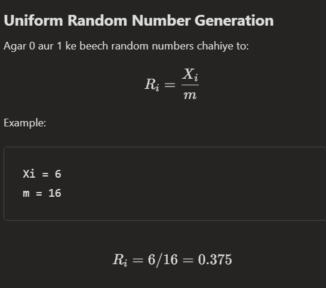

**Example Question :**

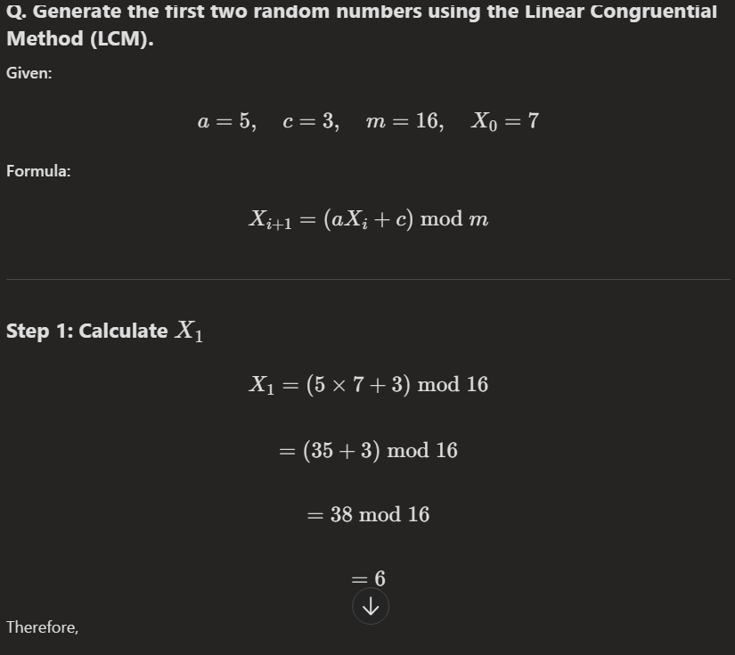
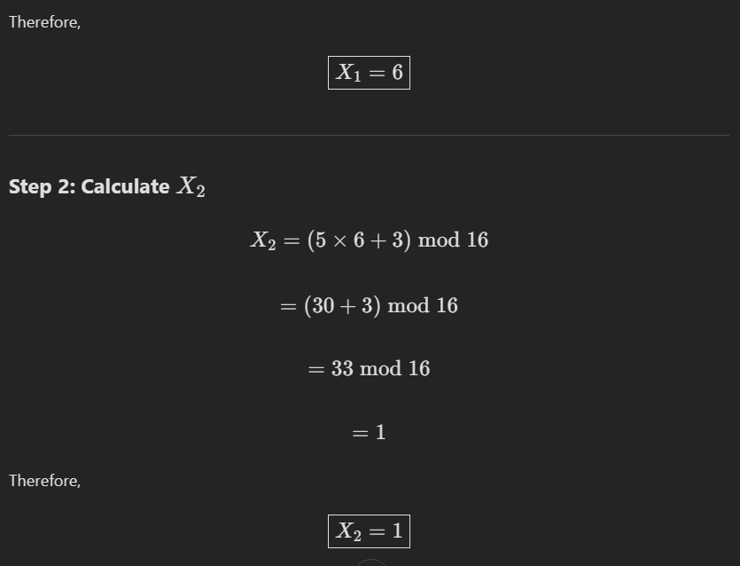
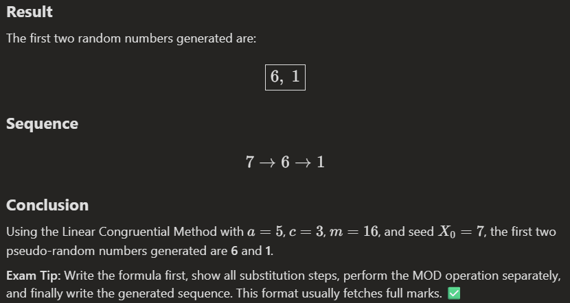

Therefore, the first two generated numbers are **6 and 1**.

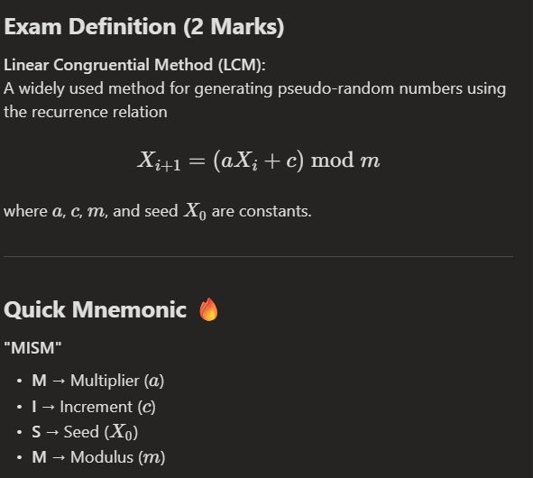

### LCM neumerical 
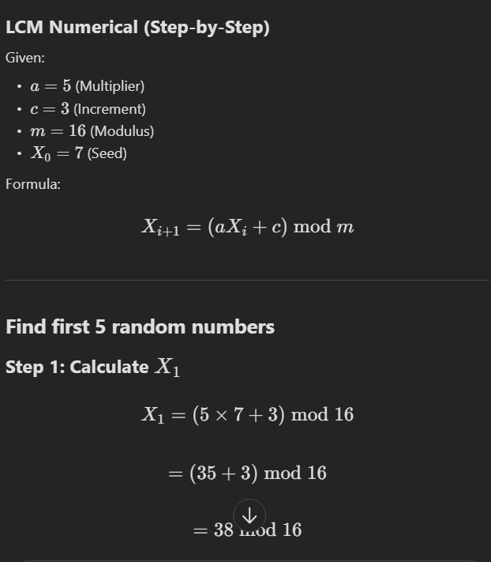
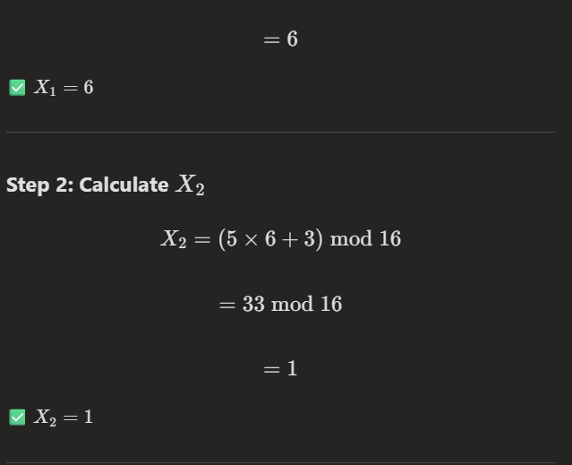
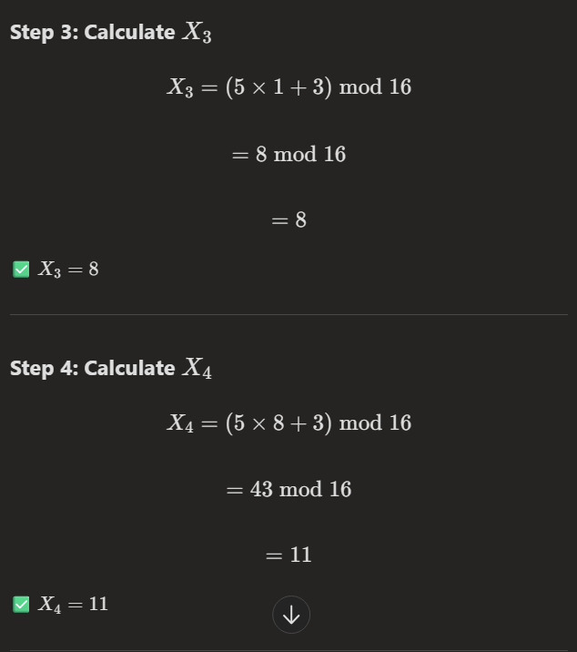
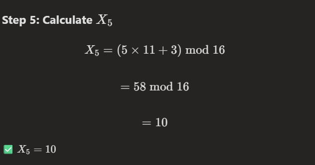
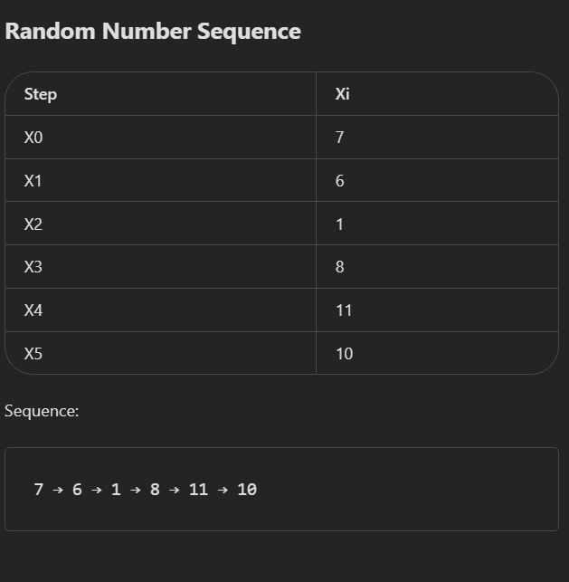
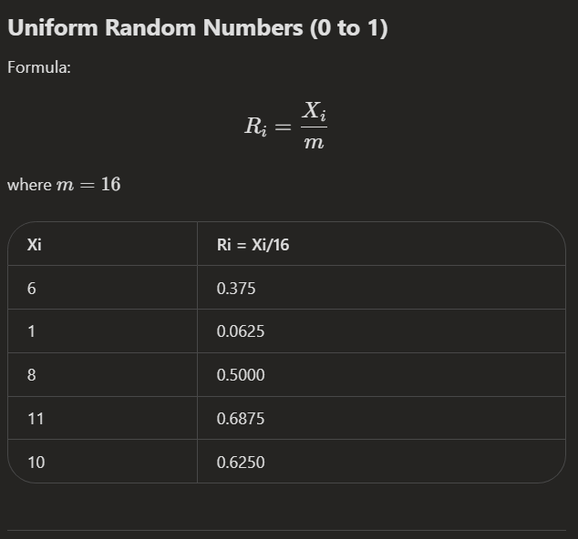

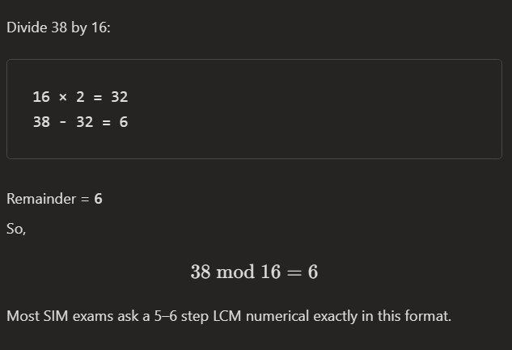

### **4. Difference Between True and Pseudo-Random Numbers**

| True Random Numbers                                     | Pseudo-Random Numbers                            |
| ------------------------------------------------------- | ------------------------------------------------ |
| Generated using physical events.                        | Generated using mathematical algorithms.         |
| Truly unpredictable.                                    | Appear random but are algorithmically generated. |
| Generally require special hardware or physical sources. | Can be generated using computer software.        |
| Difficult to reproduce the same sequence.               | Same seed produces the same sequence.            |
| Example: Electronic noise.                              | Example: Linear Congruential Method.             |

### **5. Properties of Good Random Numbers**

A good random number generator should have the following properties:

1. **Uniformity:** Numbers should be distributed evenly over the required range.
2. **Independence:** Each generated number should not depend on the previous number.
3. **Long Period:** The sequence should take a long time before repeating.
4. **Reproducibility:** The same sequence should be generated again when the same seed is used, especially for testing.
5. **Efficiency:** Numbers should be generated quickly using minimum computer resources.

### **6. Applications in Simulation**

Random number generation is used in:

- Banking simulations to generate customer arrival times.
- Traffic simulations to represent vehicle movement.
- Manufacturing simulations to represent machine failures.
- Computer networks to simulate packet arrivals.
- Weather simulations to represent uncertain conditions.

### **7. Quick Revision 📝**

**Remember these important points:**

- RNG = Generation of random numbers.
- TRNG = Uses physical events.
- PRNG = Uses mathematical algorithms.
- Seed = Initial value used to generate a sequence.
- LCM = Linear Congruential Method.

### **8. Important Exam Questions**

1. Explain the generation of random numbers in simulation.
2. Differentiate between true random and pseudo-random numbers.
3. Explain the Linear Congruential Method with an example.
4. Explain the properties of a good random number generator.

Exam tip

&#x20;For a 10–14 marks answer, prepare both generation methods, the LCM formula with a numerical example, and the properties of good random numbers.

**Next topic:** Uniform and Non-Uniform Random Numbers.
