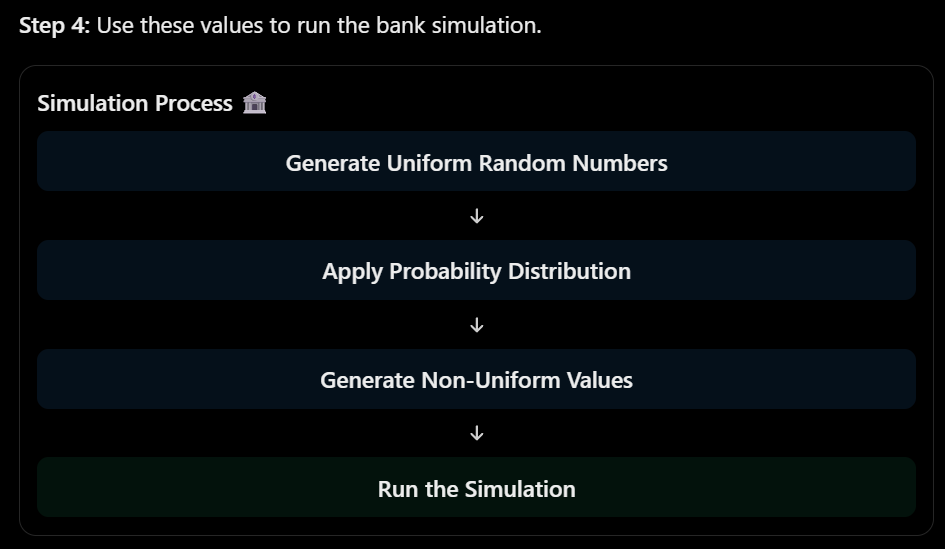

# **Module II – Probability Concepts in Simulation**

## **Topic 6: Uniform and Non-Uniform Random Numbers**

### **1. Introduction**

In simulation, random numbers are used to represent uncertain events such as customer arrivals, waiting times and machine failures.

Based on how these numbers are distributed, they can be classified into two types:

1. Uniform Random Numbers
2. Non-Uniform Random Numbers

## **2. Uniform Random Numbers**

**Definition:** Uniform random numbers are numbers in which every possible value within a given range has an equal chance of occurring.

In simple words, no number is more likely to occur than another within the specified range.

**Example: 🎲**

Suppose we generate random numbers between 0 and 1.

Some possible values are:

`0.12, 0.35, 0.67, 0.89, 0.45`

In a uniform distribution, every value within this range has an equal probability density.

**Characteristics:**

- Every value within the given range is equally likely.
- Numbers are spread evenly across the range.
- They are commonly generated using computer algorithms.
- They are used as the starting point for generating other types of random numbers.

**Example from daily life:**

A fair dice has six possible outcomes. Each outcome has an equal chance of appearing.

## **3. Non-Uniform Random Numbers**

**Definition:** Non-uniform random numbers are numbers in which different values have different chances of occurring.

In simple words, some values are more likely to occur than others.

These numbers are generated according to distributions such as Normal, Exponential and Poisson distributions.

**Example: 🏦**

Suppose we study the service time of customers in a bank.

- Most customers may take around 5 minutes.
- Some customers may take 10 minutes.
- Very few customers may take 20 minutes.

Here, different service times do not have equal chances of occurring. Therefore, the values follow a non-uniform distribution.

**Characteristics:**

- Different values have different probabilities.
- Some values occur more frequently than others.
- They represent real-world situations more realistically.
- They are generated using specific probability distributions.

**Examples:**

- Normal distribution – Human height.
- Exponential distribution – Time between customer arrivals.
- Poisson distribution – Number of customers arriving in a given time.

## **4. Difference Between Uniform and Non-Uniform Random Numbers**

| Uniform Random Numbers                                      | Non-Uniform Random Numbers                                |
| ----------------------------------------------------------- | --------------------------------------------------------- |
| Every value within the range has equal probability density. | Different values have different probability densities.    |
| Values are evenly distributed across the range.             | Values may be concentrated around certain regions.        |
| Simple to generate.                                         | Often require additional calculations or transformations. |
| Used when all values are equally likely.                    | Used when some values are more likely than others.        |
| Example: Uniform distribution between 0 and 1.              | Example: Normal and Exponential distributions.            |

## **5. How Are They Used in Simulation?**

Let's understand with a banking example.

**Step 1:** Generate uniform random numbers between 0 and 1.

**Step 2:** Use these numbers with a suitable probability distribution.

**Step 3:** Convert them into customer arrival times or service times.

**Step 4:** Use these values to run the bank simulation.

**Simulation Process 🏦**

**Generate Uniform Random Numbers**

**Apply Probability Distribution**

**Generate Non-Uniform Values**

**Run the Simulation**

## **6. Importance in Simulation**

1. Uniform random numbers provide the basic random values needed for simulation.
2. Non-uniform random numbers help represent real-world situations.
3. They help model customer arrivals, service times and machine failures.
4. They make simulation experiments more realistic.

## **7. Quick Revision 📝**

| Uniform                       | Non-Uniform                     |
| ----------------------------- | ------------------------------- |
| Equal probability density     | Different probability densities |
| Even distribution             | Uneven distribution             |
| Example: Uniform distribution | Example: Normal distribution    |
| All values equally likely     | Some values more likely         |

**Remember:**

- Uniform = Equal chance.
- Non-Uniform = Unequal chance.

## **8. Important Exam Questions**

1. Define uniform random numbers with an example.
2. Explain non-uniform random numbers with suitable examples.
3. Differentiate between uniform and non-uniform random numbers.
4. Explain how uniform random numbers are used to generate non-uniform random numbers.

Exam tip

&#x20;For a 10–14 marks answer, write both definitions, characteristics, examples, the comparison table and the simulation flowchart.

**Next topic:** Variance Reduction Techniques.