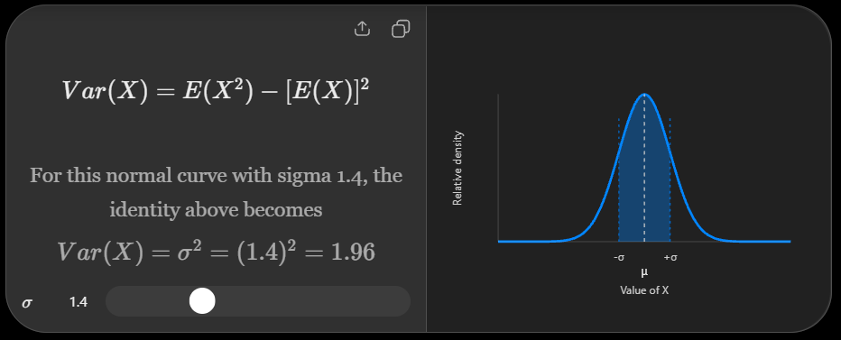
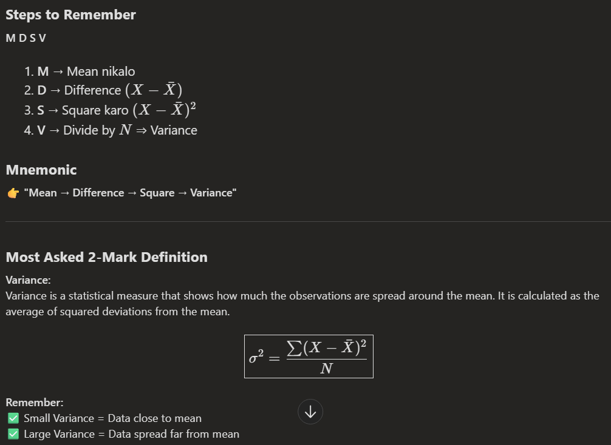
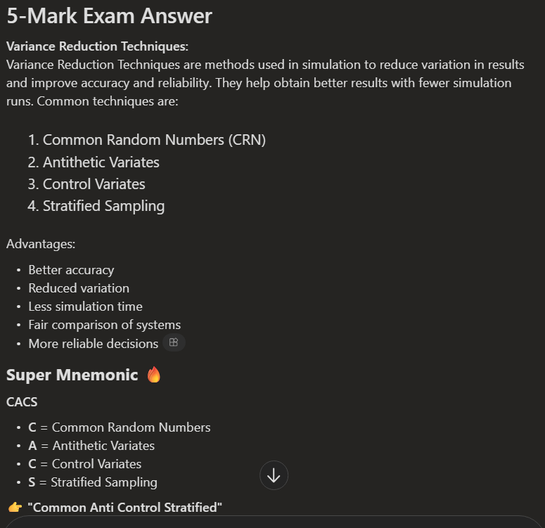

# **Module II – Probability Concepts in Simulation**

## **Topic 7: Variance Reduction Techniques**

### **1. What is Variance?**

Before understanding variance reduction, let's understand variance.

**Variance** tells us how much the results differ or spread out from their average value.

- Low variance means results are close to the average.
- High variance means results are spread far from the average.

For example, suppose we simulate the waiting time of customers in a bank several times. If the results are very different in every run, the variance is high.

\\(Var(X) = E(X^2) - [E(X)]^2\\)

For this normal curve with sigma 1.4, the identity above becomes

\\(Var(X)=\sigma^2=(\text{1.4})^2=\text{1.96}\\)

\\(\sigma\\)

μ-σ+σValue of XRelative density

### **2. What are Variance Reduction Techniques?**

**Definition:** Variance Reduction Techniques are methods used in simulation to reduce the variation in results and make them more accurate and reliable.

In simple words, these techniques help us get more consistent simulation results without always needing a large number of simulation runs.

### **3. Why Are Variance Reduction Techniques Needed?**

1. **Improve Accuracy:** They help produce more reliable simulation results.
2. **Reduce Variation:** They reduce unnecessary differences between simulation results.
3. **Save Time:** They can reduce the number of simulation runs needed to achieve a desired level of accuracy.
4. **Better Comparison:** They help compare different systems or methods more fairly.
5. **Improve Reliability:** They make the conclusions of simulation experiments more dependable.

### **4. Common Variance Reduction Techniques**

There are several techniques used to reduce variance in simulation.

**1. Common Random Numbers (CRN)**

In this method, the same random numbers are used when comparing two or more simulation systems.

This helps make a fair comparison because both systems experience similar random conditions.

*Example:* Comparing two bank service systems using the same customer arrival times.

**2. Antithetic Variates**

In this method, pairs of opposite random values are used to reduce variation in simulation results.

*Example:* If one random value is 0.2, its opposite value can be 0.8 (using \\(1-U\\)).

**3. Control Variates**

In this method, a known value related to the simulation is used to improve the accuracy of the estimated result.

*Example:* Using a known average value to improve the estimation of a related unknown value.

**4. Stratified Sampling**

In this method, data is divided into smaller groups, and samples are taken from each group.

This ensures that all important groups are represented in the simulation.

*Example:* Dividing customers into age groups and selecting samples from each group.

### **5. Advantages of Variance Reduction Techniques**

- Improve the accuracy of simulation results.
- Reduce unnecessary variation.
- Save simulation time and computational resources.
- Help compare different systems effectively.
- Increase the reliability of decisions.

### **6. Quick Revision 📝**

| Technique             | Simple meaning                                   |
| --------------------- | ------------------------------------------------ |
| Common Random Numbers | Use the same random numbers for comparison.      |
| Antithetic Variates   | Use opposite random values in pairs.             |
| Control Variates      | Use a known related value to improve estimation. |
| Stratified Sampling   | Divide data into groups and sample each group.   |

### **7. Important Exam Questions**

1. Define variance reduction techniques and explain their importance.
2. Why are variance reduction techniques required in simulation?
3. Explain different variance reduction techniques with examples.
4. Write short notes on Common Random Numbers and Antithetic Variates.

Exam tip

&#x20;For a 10–14 marks answer, prepare the definition, need, four techniques with examples and advantages.

**Next topic:** Common Random Numbers (CRN).
