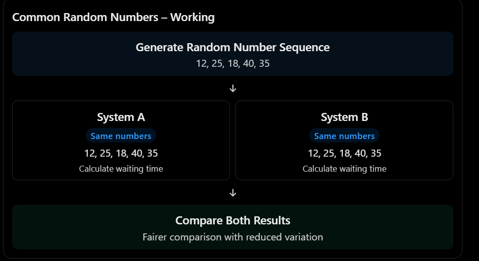

# **Module II – Probability Concepts in Simulation**

## **Topic 8: Common Random Numbers (CRN)**

### **1. What are Common Random Numbers?**

**Definition:** Common Random Numbers (CRN) is a variance reduction technique in which the same sequence of random numbers is used in two or more simulation systems to compare their results.

In simple words, instead of giving different random numbers to each system, we give them the same random numbers so that their performance can be compared fairly.

### **2. Simple Example 🏦**

Suppose a bank wants to compare two customer service systems:

- **System A:** One service counter.
- **System B:** Two service counters.

We want to find out which system provides faster service.

Without CRN:

- System A gets one set of random customer arrival times.
- System B gets a different set of random customer arrival times.
- Comparing their results may be unfair because the customer arrival patterns are different.

With CRN:

- Both systems get the same customer arrival times.
- Both systems experience similar random conditions.
- We can compare their waiting times more fairly.

### **3. How Does CRN Work?**

**Common Random Numbers – Working**

### **4. Advantages of CRN**

1. **Reduces Variance:** Helps reduce variation when comparing simulation systems.
2. **Fair Comparison:** Both systems experience the same random conditions.
3. **Improves Accuracy:** Makes the comparison of simulation results more reliable.
4. **Saves Time:** Can help achieve reliable comparisons with fewer simulation runs.
5. **Easy to Implement:** It can be implemented by using the same random number streams in different systems.

### **5. Limitations of CRN**

1. It requires proper synchronization of random numbers.
2. It may not reduce variance in every situation.
3. If random numbers are not properly matched, the comparison may become misleading.

### **6. Quick Revision 📝**

| Point     | Explanation                                       |
| --------- | ------------------------------------------------- |
| Full form | Common Random Numbers                             |
| Type      | Variance Reduction Technique                      |
| Main idea | Use the same random numbers in different systems. |
| Purpose   | Make system comparisons more reliable.            |
| Example   | Comparing two bank service systems.               |

### **7. Important Exam Questions**

1. Define Common Random Numbers (CRN).
2. Explain the working of CRN with a suitable example.
3. Explain the advantages and limitations of CRN.
4. How does CRN help in reducing variance in simulation?

Remember this

**CRN = Same random numbers + Different systems + Fair comparison.**

The main purpose is to reduce unwanted variation while comparing two or more simulation systems.

**Next topic:** Rationale, Applicability and Synchronization of Common Random Numbers.