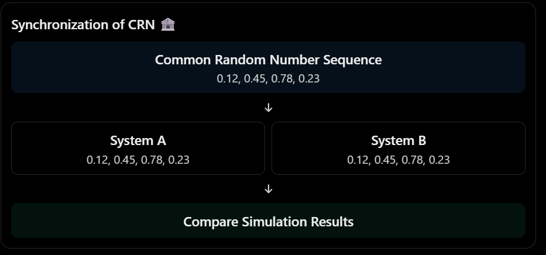

# **Module II – Probability Concepts in Simulation**

## **Topic 9: Rationale, Applicability and Synchronization of Common Random Numbers (CRN)**

### **1. Introduction**

Common Random Numbers (CRN) is a technique used to compare two or more simulation systems by giving them the same random number sequences.

It helps make the comparison fair and can reduce unnecessary variation in simulation results.

There are three important aspects of CRN:

1. Rationale – Why do we use CRN?
2. Applicability – When should we use CRN?
3. Synchronization – How do we use the same random numbers correctly?

## **2. Rationale of CRN (Why is it needed?)**

**Rationale means the reason for using Common Random Numbers.**

The main reason for using CRN is to reduce variation while comparing different simulation systems.

Let's understand with an example.

Suppose we want to compare two bank service systems:

- System A has one service counter.
- System B has two service counters.

If both systems receive different customer arrival patterns, their waiting times may differ because of the arrival patterns, not just because of the number of counters.

By using the same random numbers, both systems receive similar customer arrival conditions.

**Benefits:**

- Makes comparison fair.
- Reduces unwanted variation.
- Improves reliability of results.
- Helps identify which system performs better.

## **3. Applicability of CRN (Where is it used?)**

**Applicability means the situations in which CRN can be used effectively.**

CRN is useful when we want to compare two or more systems under similar random conditions.

**Examples:**

1\. **Banking System:** Comparing waiting times in two different bank service systems.

2\. **Computer Networks:** Comparing the performance of two network protocols using the same traffic conditions.

3\. **Manufacturing:** Comparing two production methods using similar machine failure patterns.

4\. **Traffic Management:** Comparing two traffic signal systems using similar vehicle arrival patterns.

**Important condition:** CRN is most useful when the random events in different systems can be matched meaningfully and the resulting outputs are positively correlated. It does not guarantee variance reduction in every situation.

## **4. Synchronization of CRN (How does it work?)**

**Synchronization means matching the random numbers used in different simulation systems so that they represent the same random events.**

For example, when comparing two bank systems, the first random number should represent the first customer's arrival in both systems, the second should represent the second customer's arrival, and so on.

**Working steps:**

1. Generate a sequence of random numbers.
2. Use the same sequence for both simulation systems.
3. Match corresponding random events in both systems.
4. Run both simulations.
5. Compare their results.

**Synchronization of CRN 🏦**

**Common Random Number Sequence**

0.12, 0.45, 0.78, 0.23

**System A**

0.12, 0.45, 0.78, 0.23

**System B**

0.12, 0.45, 0.78, 0.23

**Compare Simulation Results**

**Why is synchronization important?**

If random numbers are not properly matched, both systems may experience different random conditions. This can make the comparison unfair and reduce the benefit of CRN.

## **5. Difference Between Rationale, Applicability and Synchronization**

| Aspect          | Meaning             | Main focus                              |
| --------------- | ------------------- | --------------------------------------- |
| Rationale       | Why CRN is used     | Reduce variation and improve comparison |
| Applicability   | Where CRN is useful | Comparing different systems             |
| Synchronization | How CRN is applied  | Matching random numbers correctly       |

## **6. Quick Revision 📝**

- **Rationale:** Why do we need CRN? To make comparisons more reliable.
- **Applicability:** Where do we use CRN? Banking, networks, manufacturing and traffic systems.
- **Synchronization:** How does CRN work? By matching random numbers for corresponding events.

## **7. Important Exam Questions**

1. Explain the rationale of Common Random Numbers.
2. Discuss the applicability of CRN in simulation.
3. What is synchronization in CRN? Explain its importance.
4. Explain the rationale, applicability and synchronization of CRN with a suitable example.

Exam tip

&#x20;This topic can be prepared as a 10–14 marks answer. Remember the three keywords: **Why (Rationale), Where (Applicability), How (Synchronization).**

Module II completed

You've covered all the topics in Module II from stochastic variables to CRN synchronization.

Next, we can start **Module III – Introduction to Queuing Theory**.