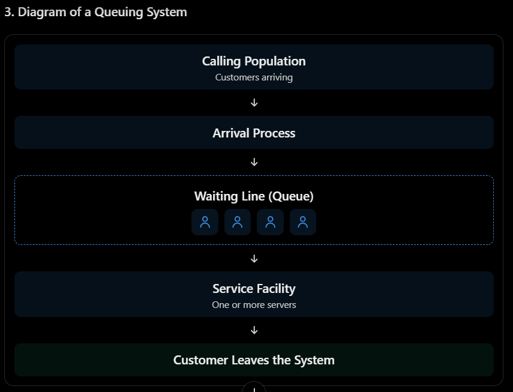

# **Module III – Introduction to Queuing Theory**

## **Topic 1: Characteristics of Queuing Systems**

### **1. Introduction**

A **queuing system** is a system in which customers, people or objects arrive, wait for their turn and receive service.

For example, when customers visit a bank, they may have to wait in a line until a bank employee becomes available.

A queuing system has some important characteristics that describe how it works.

### **2. Main Characteristics of Queuing Systems**

**1. Calling Population**

It refers to the total group of people or objects that may come for service.

*Example:* All customers who may visit a bank.

**2. Arrival Process**

It describes how customers arrive at the system and how much time passes between their arrivals.

*Example:* Five customers may arrive at a bank within 10 minutes.

**3. Service Mechanism**

It describes how customers receive service and how many servers are available.

*Example:* A bank may have two employees working at separate counters.

**4. Number of Service Channels**

It refers to the number of service counters or servers available.

- Single channel: Only one server is available.
- Multiple channels: More than one server is available.

*Example:* A bank with one counter has a single-channel system, while a bank with four counters has a multiple-channel system.

**5. Number of Service Phases**

It refers to the number of steps a customer must complete to receive the full service.

- Single phase: Service is completed in one step.
- Multiple phases: Service is completed in two or more steps.

*Example:* In a hospital, a patient may first register, then consult a doctor and finally collect medicine. This is a multiple-phase system.

**6. Queue Capacity**

It refers to the maximum number of customers that can wait in the system.

- Limited capacity: Only a fixed number of customers can wait.
- Unlimited capacity: There is no fixed limit on the number of customers who can wait.

*Example:* A small ticket counter waiting area may have limited space.

**7. Queue Discipline**

It defines the rule or order in which customers receive service.

Common types include:

- FCFS – First Come, First Served.
- LCFS – Last Come, First Served.
- SIRO – Service in Random Order.
- Priority – Customers are served according to their priority.

**8. Service Time**

It is the amount of time required to serve one customer.

*Example:* If a bank employee takes 5 minutes to complete one customer's work, the service time is 5 minutes.

### **3. Diagram of a Queuing System**

**Calling Population**

Customers arriving

**Arrival Process**

**Waiting Line (Queue)**

**Service Facility**

One or more servers

**Customer Leaves the System**

### **4. Example: Queuing System in a Bank 🏦**

Suppose a bank has two service counters.

- Customers arrive at the bank.
- They wait in a queue if both employees are busy.
- The employee serves the customer.
- After completing the work, the customer leaves.

In this example:

- Calling population = Bank customers.
- Arrival process = Customers entering the bank.
- Service channels = Two counters.
- Queue discipline = First Come, First Served.
- Service time = Time taken by an employee to serve a customer.

### **5. Importance of Queuing System Characteristics**

1. Help understand how a waiting line works.
2. Help calculate customer waiting time.
3. Help decide how many service counters are required.
4. Help reduce long queues.
5. Help improve the overall performance of a service system.

### **6. Quick Revision 📝**

| Characteristic     | Meaning                         |
| ------------------ | ------------------------------- |
| Calling Population | Group of possible customers     |
| Arrival Process    | How customers arrive            |
| Service Mechanism  | How customers are served        |
| Service Channels   | Number of servers               |
| Service Phases     | Number of service steps         |
| Queue Capacity     | Maximum waiting capacity        |
| Queue Discipline   | Rule for serving customers      |
| Service Time       | Time needed to serve a customer |

### **7. Important Exam Questions**

1. Define a queuing system and explain its characteristics.
2. Explain the basic characteristics of a queuing system with a suitable example.
3. Explain calling population, arrival process, service mechanism and queue discipline.
4. Differentiate between single-channel and multiple-channel systems.
5. Explain single-phase and multiple-phase queuing systems.

Exam tip

&#x20;For a 10–14 marks answer, write the definition, explain the eight characteristics, draw the queuing system diagram and give the banking example.

**Next topic: Poisson's Formula** — we'll understand it from the basics with a simple numerical example.