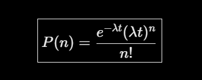
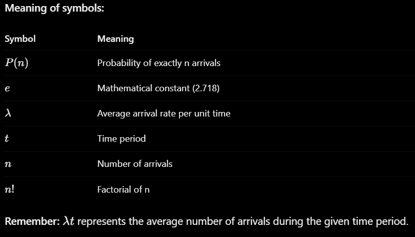
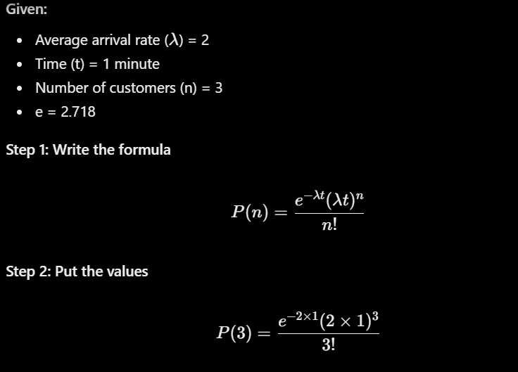
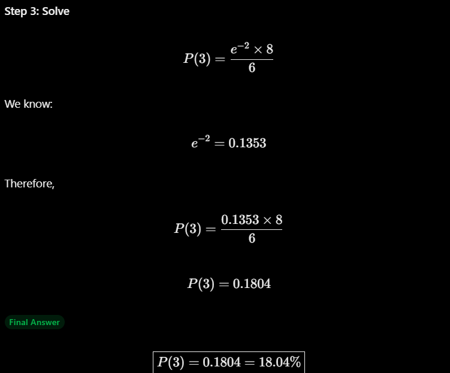
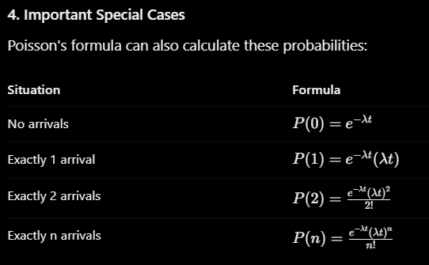
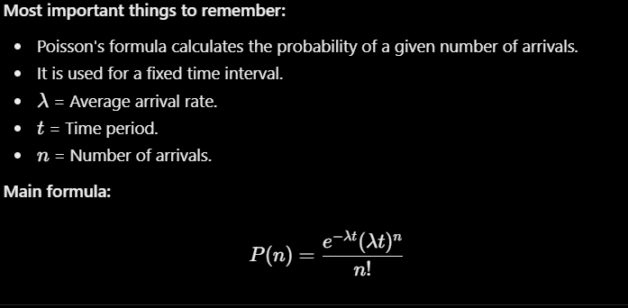

# **Module III – Introduction to Queuing Theory**

## **Topic 2: Poisson's Formula**

### **1. What is Poisson's Formula?**

**Definition:** Poisson's Formula is used to calculate the probability of a particular number of customers or events occurring within a fixed period of time.

In simple words, it tells us the chance of how many customers may arrive at a bank, hospital or service counter during a given time.

It is commonly used in queuing theory because customer arrivals are often random.

### **2. Poisson's Formula**

The formula is:

\\[ \boxed{P(n)=\frac{e^{-\lambda t}(\lambda t)^n}{n!}} \\]

**Meaning of symbols:**

**Remember:** \\(\lambda t\\) represents the average number of arrivals during the given time period.

### **3. Example of Poisson's Formula 🏦**

Suppose a bank receives an average of **2 customers per minute**.

Find the probability that exactly 3 customers will arrive in one minute.

**Given:**

- Average arrival rate (\\(\lambda\\)) = 2
- Time (t) = 1 minute
- Number of customers (n) = 3
- e = 2.718

**Meaning:** There is an 18.04% chance that exactly 3 customers will arrive at the bank in one minute.

### **4. Important Special Cases**

Poisson's formula can also calculate these probabilities:

### **5. Assumptions of Poisson's Formula**

Poisson's formula works under these conditions:

1. Events occur randomly and independently.
2. The average arrival rate remains constant.
3. Two or more arrivals do not occur at exactly the same instant.
4. The number of arrivals is counted within a fixed time period.
5. The probability of an arrival in a very small time interval is proportional to the length of that interval.

### **6. Applications of Poisson's Formula**

- **Banking:** Calculating the probability of customer arrivals.
- **Hospitals:** Estimating the number of patients arriving.
- **Computer Networks:** Calculating the number of packets arriving at a server.
- **Transportation:** Estimating vehicle arrivals at a traffic signal.
- **Manufacturing:** Estimating machine breakdown occurrences.

### **7. Quick Revision 📝**

**Main formula:**

\\[ P(n)=\frac{e^{-\lambda t}(\lambda t)^n}{n!} \\]

### **8. Important Exam Questions**

1. Explain Poisson's formula in queuing theory.
2. Write the assumptions and applications of Poisson's formula.
3. Explain Poisson's formula with a suitable numerical example.
4. A bank receives an average of 4 customers per minute. Find the probability of exactly 2 customers arriving in one minute.

**Exam tip:** This topic is important because it involves both theory and numerical problems. Practise the formula and at least two numerical examples.

**Next topic: Birth-Death System** — we'll understand how customers enter and leave a queuing system.