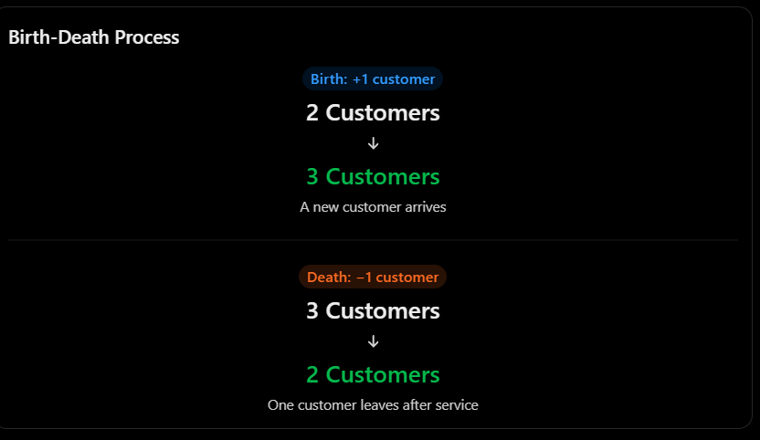

# **Module III – Introduction to Queuing Theory**

## **Topic 3: Birth-Death System**

### **1. What is a Birth-Death System?**

**Definition:** A Birth-Death System is a type of queuing model in which the number of customers in a system changes because of two activities: arrivals (Births) and departures (Deaths).

In simple words:

- **Birth:** A new customer enters the system.
- **Death:** A customer completes the service and leaves the system.

It is commonly used in banks, hospitals, computer networks and other service systems.

### **2. Meaning of Birth and Death 🏦**

**1. Birth (Arrival)**

Birth means the arrival of a new customer in the queuing system. Whenever a new customer enters, the total number of customers in the system increases by one.

*Example:* A new customer enters a bank and joins the queue.

**2. Death (Departure)**

Death means a customer leaves the system after completing the service. Whenever a customer leaves, the total number of customers decreases by one.

*Example:* A customer completes a banking transaction and leaves the bank.

### **3. Working of a Birth-Death System**

Let's understand with a simple example.

Suppose a bank has one service counter.

- Initially, there are 2 customers in the system.
- One new customer arrives. The total becomes 3. This is called Birth.
- One customer completes the service and leaves. The total becomes 2. This is called Death.

**Birth-Death Process**

### **4. Important Terms Used in Birth-Death System**

There are two important rates:

**1. Birth Rate (λ)**

It represents the average rate at which new customers arrive in the system.

*Example:* If 5 customers arrive per minute, the birth rate is 5 customers per minute.

**2. Death Rate (μ)**

It represents the average rate at which customers complete their service and leave the system.

*Example:* If a server serves 4 customers per minute, its service rate is 4 customers per minute when continuously busy.

### **5. State of a Birth-Death System**

The **state** represents the total number of customers currently present in the system.

For example:

| State | Meaning         |
| ----- | --------------- |
| 0     | No customers    |
| 1     | One customer    |
| 2     | Two customers   |
| 3     | Three customers |
| 4     | Four customers  |

A birth increases the state by one, while a death decreases it by one.

### **6. Characteristics of a Birth-Death System**

1. **Two Main Events:** The system changes through arrivals and departures.
2. **One-Step Change:** Each event increases or decreases the number of customers by one.
3. **Random Behaviour:** Arrivals and departures generally occur randomly.
4. **Changing System Size:** The number of customers keeps changing over time.
5. **Uses Birth and Death Rates:** Arrival rate (λ) and departure rate (μ) describe how quickly these events occur.

### **7. Applications of Birth-Death System**

- **Banking:** Customers arrive and leave after receiving service.
- **Hospitals:** Patients enter and leave after treatment.
- **Computer Networks:** Data packets enter and leave network systems.
- **Operating Systems:** Processes enter and leave the system.
- **Manufacturing:** Products enter and leave production stages.

### **8. Difference Between Birth and Death**

| Birth                              | Death                                   |
| ---------------------------------- | --------------------------------------- |
| Means customer arrival.            | Means customer departure.               |
| Increases the number of customers. | Decreases the number of customers.      |
| Represented by λ (lambda).         | Represented by μ (mu).                  |
| Example: Customer enters a bank.   | Example: Customer leaves after service. |

### **9. Quick Revision 📝**

**Remember these four points:**

- Birth = Arrival (+1).
- Death = Departure (−1).
- λ = Birth or arrival rate.
- μ = Death or service rate.

**Easy formula to remember:**

New state = Current state + Birth − Death

### **10. Important Exam Questions**

1. Define Birth-Death System and explain its working with a suitable example.
2. Explain birth rate and death rate in a queuing system.
3. Explain the characteristics of a Birth-Death System.
4. Differentiate between birth and death in queuing theory.
5. Explain the applications of Birth-Death Systems.

Exam tip

&#x20;For a 10–14 marks answer, prepare the definition, birth and death concepts, diagram, birth/death rates, characteristics and applications.

**Next topic: Equilibrium of Queuing Systems** — we'll understand what happens when the arrival and service processes reach a stable condition.