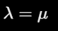
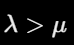
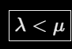

# **Module III – Introduction to Queuing Theory**

## **Topic 4: Equilibrium of Queuing Systems**

### **1. What is Equilibrium in a Queuing System?**

**Definition:** Equilibrium of a queuing system is a condition in which the system becomes stable and its average behaviour does not change with time.

In simple words, it means customers are arriving and leaving the system at a rate that allows the queue to remain stable in the long run.

**Example: 🏦**

Suppose customers arrive at a bank at an average rate of 4 customers per minute, and the employee can serve 6 customers per minute.

Since the employee can serve customers faster than they arrive, the queue can remain stable in the long run.

### **2. How Does Equilibrium Work?**

A queuing system has two main activities:

- **Arrival Rate (λ):** Average number of customers entering the system.
- **Service Rate (μ):** Average number of customers served per unit of time by a server.

For a simple single-server queue, the stability condition is:

\\[ \boxed{\lambda < \mu} \\]

This means the service rate must be greater than the arrival rate.

**Example:**

| Arrival Rate (λ) | Service Rate (μ) | Condition |
| ---------------- | ---------------- | --------- |
| 4 customers/min  | 6 customers/min  | Stable    |
| 5 customers/min  | 5 customers/min  | Critical  |
| 7 customers/min  | 4 customers/min  | Unstable  |

### **3. Types of Queuing Conditions**

**1. Stable Condition**

A system is stable when the service rate is greater than the arrival rate.

\\[ \lambda < \mu \\]

*Example:* 4 customers arrive per minute, while 6 customers are served per minute.

Stable

**2. Critical Condition**

A system is in a critical condition when the arrival rate and service rate are equal.

\\[ \lambda = \mu \\]

*Example:* 5 customers arrive per minute and 5 customers are served per minute.

The system has no extra service capacity to handle fluctuations in arrivals.

**3. Unstable Condition**

A system becomes unstable when the arrival rate is greater than the service rate.

\\[ \lambda > \mu \\]

*Example:* 8 customers arrive per minute, but only 5 customers are served per minute.

Unstable

The waiting line may keep growing if this condition continues.

### **4. Conditions Required for Equilibrium**

1. **Constant Arrival Rate:** The average customer arrival rate should remain stable.
2. **Sufficient Service Capacity:** The service system should be capable of handling incoming customers.
3. **Stable Queue:** The average number of customers waiting should not continuously increase.
4. **Steady Behaviour:** The average waiting time and queue length should settle into long-term values.
5. **Proper System Operation:** The service facility should operate without continuous interruptions.

### **5. Importance of Equilibrium in Queuing Systems**

- Helps determine whether a queue is stable or unstable.
- Helps prevent unnecessarily long waiting lines.
- Helps decide how many service counters are required.
- Helps improve customer service.
- Helps in planning resources and reducing operating costs.

### **6. Quick Revision 📝**

| Condition        | Meaning                       |
| ---------------- | ----------------------------- |
| λ = Arrival Rate | Customers entering the system |
| μ = Service Rate | Customers being served        |
| λ less than μ    | Stable system                 |
| λ equal to μ     | Critical condition            |
| λ greater than μ | Unstable system               |

**Remember this important formula:**

\\[ \boxed{\lambda < \mu} \\]

For a basic single-server queue, this is the condition for long-term stability.

**Easy trick:**

- Arrival slower than service = Stable.
- Arrival equal to service = Critical.
- Arrival faster than service = Unstable.

### **7. Important Exam Questions**

1. Define equilibrium of a queuing system.
2. Explain the conditions required for equilibrium.
3. Differentiate between stable, critical and unstable queuing systems.
4. Explain the importance of equilibrium in queuing theory.
5. Explain the relationship between arrival rate and service rate.

Exam tip

&#x20;For a 10–14 marks answer, prepare the definition, arrival and service rates, three conditions with formulas, examples and importance.

**Next topic: Queuing Disciplines** — we'll learn the different rules used to decide which customer gets served first.