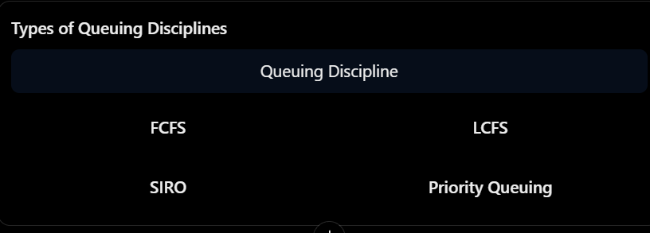
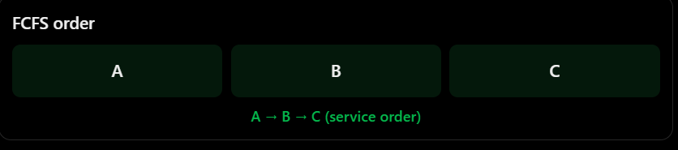
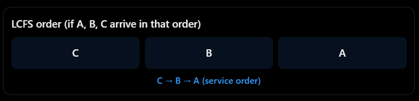
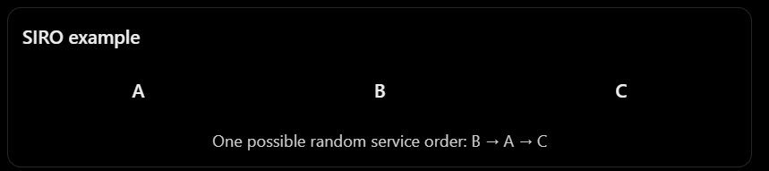
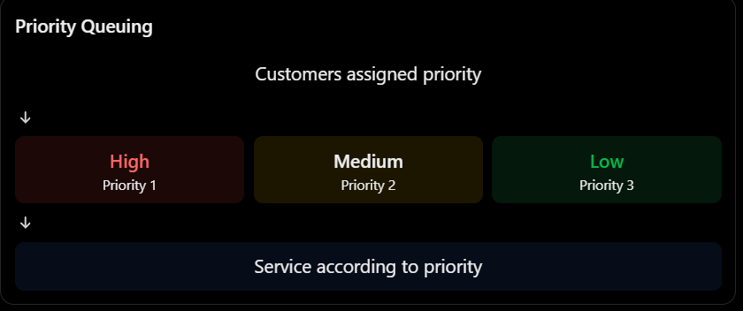

# **Module III – Important Exam Questions: Queuing Disciplines**

## **Q1. Define Queuing Discipline and explain its different types.**

### **Definition**

A **Queuing Discipline** is a rule that decides the order in which customers or jobs are selected from a waiting line for service.

It determines who will be served first when multiple customers are waiting in a queue.

### **Types of Queuing Disciplines**

**1. FCFS (First Come, First Served)**

- The customer who arrives first gets service first.
- It follows the arrival order.
- Example: People standing in a bank queue.

**2. LCFS (Last Come, First Served)**

- The customer who arrives last gets service first.
- The newest customer is served before older waiting customers.
- Example: A stack of plates where the last plate placed on top is removed first.

**3. SIRO (Service in Random Order)**

- Customers are selected randomly for service.
- There is no fixed arrival order or priority.
- Example: A random lottery system used to select one person from a group.

**4. Priority Queuing**

- Customers are served according to their priority level.
- High-priority customers are served before low-priority customers.
- Example: Emergency patients are treated before patients with minor problems.

### **Diagram**

**Conclusion:** Queuing disciplines help manage waiting lines and decide the order of service in banks, hospitals, computer systems and networks.

## **Q2. Explain FCFS, LCFS and SIRO with examples.**

These are three common methods used to decide which customer will receive service first.

### **1. FCFS – First Come, First Served**

- In FCFS, the customer who arrives first receives service first.
- It follows the same order in which customers enter the queue.
- It is also called FIFO (First In, First Out).

**Example:** In a bank, if A arrives before B and C, then A will be served first, followed by B and C.

### **2. LCFS – Last Come, First Served**

- In LCFS, the customer who arrives last receives service first.
- The most recently arrived customer is selected before older waiting customers.
- It is also called LIFO (Last In, First Out).

**Example:** In a stack of books, the last book placed on top is removed first.

### **3. SIRO – Service in Random Order**

- In SIRO, customers are selected randomly for service.
- The selection does not depend on arrival time.
- Every waiting customer may be selected according to the random selection rule.

**Example:** A computer system randomly selects one job from a group of waiting jobs.

**SIRO example**

### **Difference between FCFS, LCFS and SIRO**

| Basis     | FCFS                     | LCFS                    | SIRO                        |
| --------- | ------------------------ | ----------------------- | --------------------------- |
| Full form | First Come, First Served | Last Come, First Served | Service in Random Order     |
| Selection | First arrival            | Last arrival            | Random selection            |
| Rule      | FIFO                     | LIFO                    | Random                      |
| Fairness  | Arrival-based            | Newest first            | Depends on random selection |
| Example   | Bank queue               | Stack of books          | Random job selection        |

**Conclusion:** FCFS follows arrival order, LCFS follows reverse arrival order, and SIRO selects customers randomly.

## **Q3. What is Priority Queuing? Explain its types.**

### **Definition**

**Priority Queuing** is a queuing method in which customers or jobs are served according to their assigned priority instead of their arrival time.

A high-priority customer receives service before a low-priority customer.

### **Example**

In a hospital:

- Emergency patient – High priority
- Serious patient – Medium priority
- Normal check-up patient – Low priority

The emergency patient is served first, even if other patients arrived earlier.

### **Types of Priority Queuing**

There are two main types:

**1. Preemptive Priority Queuing**

- A high-priority customer can interrupt the service of a low-priority customer.
- The low-priority customer's service is stopped temporarily.
- After the high-priority customer finishes, the interrupted customer may continue.

**Example:** In an operating system, a high-priority process may interrupt a low-priority process.

**2. Non-Preemptive Priority Queuing**

- Once service starts, it is completed without interruption.
- Even if a high-priority customer arrives, they must wait until the current service is finished.
- After that, the highest-priority waiting customer is selected.

**Example:** In a hospital, a patient already undergoing an operation is generally not interrupted because another patient arrives.

### **Diagram**

**Conclusion:** Priority queuing is useful when some customers or jobs need faster service than others, such as emergency services and operating systems.

## **Q4. Differentiate between Preemptive and Non-Preemptive Priority.**

Both are types of priority queuing, but they differ in whether an ongoing service can be interrupted.

| Basis                 | Preemptive Priority                                   | Non-Preemptive Priority                  |
| --------------------- | ----------------------------------------------------- | ---------------------------------------- |
| Meaning               | High-priority customer can interrupt ongoing service. | Ongoing service cannot be interrupted.   |
| Interruption          | Allowed                                               | Not allowed                              |
| Current service       | May be stopped temporarily.                           | Must be completed first.                 |
| High-priority arrival | Can get immediate service if the server can preempt.  | Waits until current service finishes.    |
| Complexity            | More complex to manage.                               | Comparatively simple.                    |
| Waiting time          | Can reduce waiting time for high-priority jobs.       | High-priority jobs may have to wait.     |
| Example               | CPU scheduling with preemption                        | Printer completing the current print job |

### **Example**

Suppose a computer is processing a low-priority process.

- **Preemptive:** If a high-priority process arrives, the computer pauses the low-priority process and starts the high-priority process.
- **Non-preemptive:** The computer completes the current process first and then selects the high-priority process.

**Conclusion:** Preemptive priority allows interruption, whereas non-preemptive priority completes the ongoing service before selecting another customer.

## **Q5. Compare different Queuing Disciplines.**

A queuing discipline determines how customers are selected for service. Different disciplines are used depending on the requirements of a system.

### **Comparison Table**

| Discipline              | Selection Rule                         | Service Order                 | Example                           |
| ----------------------- | -------------------------------------- | ----------------------------- | --------------------------------- |
| FCFS                    | First arrival                          | Arrival order                 | Bank queue                        |
| LCFS                    | Last arrival                           | Reverse arrival order         | Stack of books                    |
| SIRO                    | Random selection                       | Random order                  | Random job selection              |
| Priority                | Highest priority                       | Priority order                | Hospital emergency                |
| Preemptive Priority     | Highest priority can interrupt         | Priority with interruption    | CPU scheduling                    |
| Non-Preemptive Priority | Highest priority after current service | Priority without interruption | Current print job completes first |

### **Advantages and Disadvantages**

| Discipline              | Advantage                         | Disadvantage                        |
| ----------------------- | --------------------------------- | ----------------------------------- |
| FCFS                    | Simple and easy to implement      | Important jobs may wait             |
| LCFS                    | New jobs get quick attention      | Older jobs may wait longer          |
| SIRO                    | Random selection                  | Waiting time is unpredictable       |
| Priority                | Important jobs get faster service | Low-priority jobs may suffer delays |
| Preemptive Priority     | Fast response for urgent jobs     | Interruptions add complexity        |
| Non-Preemptive Priority | Service is not interrupted        | Urgent jobs may have to wait        |

### **Applications**

1. **FCFS:** Banks, ticket counters and customer service.
2. **LCFS:** Stack-based systems and certain job-processing systems.
3. **SIRO:** Random selection of jobs.
4. **Priority:** Hospitals, emergency services and CPU scheduling.
5. **Preemptive Priority:** Real-time operating systems.
6. **Non-Preemptive Priority:** Systems where ongoing tasks should finish without interruption.

**Conclusion:** Each queuing discipline has its own advantages and limitations. The selection depends on whether the system requires fairness, random selection, or faster service for important customers.

## **Quick Revision Before Exam 📝**

| Term           | Remember this                         |
| -------------- | ------------------------------------- |
| FCFS           | First arrival gets service first      |
| LCFS           | Last arrival gets service first       |
| SIRO           | Random customer gets service          |
| Priority       | Highest priority gets service         |
| Preemptive     | Current service can be interrupted    |
| Non-preemptive | Current service cannot be interrupted |

Exam tip

&#x20;If a question asks about *different types of queuing disciplines*, write FCFS, LCFS, SIRO and Priority Queuing. If it asks about *types of priority queuing*, explain preemptive and non-preemptive priority separately.

These five questions cover the **Queuing Disciplines** portion of Module III.