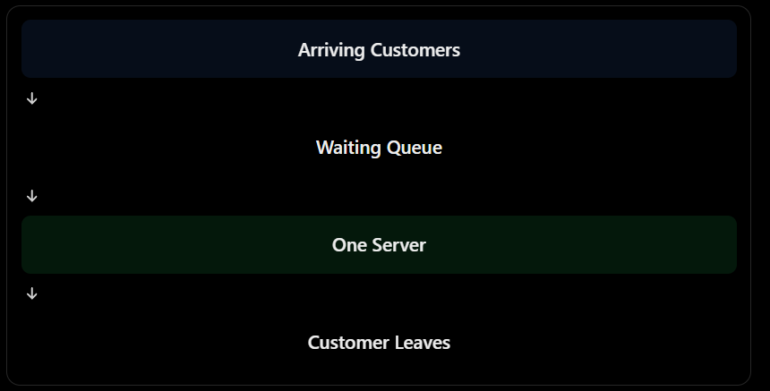
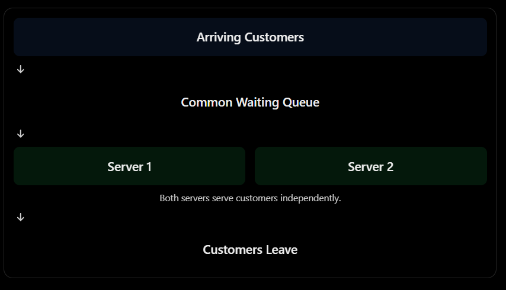

# **Module III – Simulation of Single-Server and Two-Server Queues**

These are important topics in Simulation and Modeling. Let's understand both from the basics, with diagrams, steps and numerical examples.

## **1. Simulation of a Single-Server Queue**

### **Definition**

A **single-server queue** is a waiting-line system in which only one server is available to serve customers.

If the server is busy when a new customer arrives, the customer waits in a queue. When the server becomes free, the next customer is served.

**Example:** One person serving customers at a bank counter.

### **Diagram**

### **Important Terms**

1. **Arrival Time:** The time at which a customer enters the system.
2. **Service Time:** The time required to serve a customer.
3. **Service Start Time:** The time when the server starts serving a customer.
4. **Service End Time:** The time when the service is completed.
5. **Waiting Time:** The time a customer spends waiting before service begins.
6. **Time in System:** Total time spent by a customer, including waiting and service.
7. **Server Idle Time:** The time during which the server remains free.

### **Steps to Simulate a Single-Server Queue**

1. Generate the arrival time of each customer.
2. Generate the service time required for each customer.
3. Check whether the server is free or busy.
4. If the server is free, start service immediately.
5. If the server is busy, the customer waits.
6. Calculate service completion time, waiting time and idle time.
7. Repeat the process for all customers.

### **Numerical Example**

Suppose four customers arrive at a bank counter. Their inter-arrival times and service times are given below.

| Customer | Inter-arrival time | Service time |
| -------- | ------------------ | ------------ |
| C1       | 0                  | 3            |
| C2       | 2                  | 2            |
| C3       | 1                  | 3            |
| C4       | 3                  | 2            |

Assume the first customer arrives at time 0 and customers are served using FCFS.

**Formulas:**

- Arrival Time = Previous Arrival Time + Inter-arrival Time
- Service Start Time = Maximum of (Arrival Time, Previous Service End Time)
- Service End Time = Service Start Time + Service Time
- Waiting Time = Service Start Time − Arrival Time
- Time in System = Service End Time − Arrival Time
- Idle Time = Maximum of (0, Current Arrival Time − Previous Service End Time)

**Calculation table:**

Arrival times are 0, 2, 3 and 6.

| Customer | Arrival | Service start | Service end | Waiting time | Time in system |
| -------- | ------- | ------------- | ----------- | ------------ | -------------- |
| C1       | 0       | 0             | 3           | 0            | 3              |
| C2       | 2       | 3             | 5           | 1            | 3              |
| C3       | 3       | 5             | 8           | 2            | 5              |
| C4       | 6       | 8             | 10          | 2            | 4              |

**Explanation:**

- C1 arrives at time 0 and starts service immediately.
- C2 arrives at time 2, but the server is busy until time 3. Therefore, C2 waits for 1 unit.
- C3 arrives at time 3, but C2 is being served until time 5. So C3 waits for 2 units.
- C4 arrives at time 6, but C3 is being served until time 8. So C4 waits for 2 units.

**Results:**

- Total waiting time = 0 + 1 + 2 + 2 = 5 units.
- Average waiting time = 5 / 4 = **1.25 units**.
- Total service time = 10 units.
- Server idle time = 0 units during the observation period (0–10).

## **2. Simulation of a Two-Server Queue**

### **Definition**

A **two-server queue** is a waiting-line system in which two servers are available to serve customers.

Customers enter a common queue and are served by whichever server becomes available first. If both servers are busy, new customers wait in the queue.

**Example:** A bank having two counters serving customers.

### **Diagram**

### **Steps to Simulate a Two-Server Queue**

1. Generate the arrival time and service time of each customer.
2. Check the availability of both servers.
3. If one server is free, assign the customer to it.
4. If both servers are busy, place the customer in the common waiting queue.
5. When a server becomes free, select the next customer from the queue.
6. Calculate waiting time, service completion time and idle time for both servers.
7. Repeat until all customers are served.

### **Numerical Example**

Consider the same four customers with the following arrival and service times.

| Customer | Arrival time | Service time |
| -------- | ------------ | ------------ |
| C1       | 0            | 3            |
| C2       | 2            | 2            |
| C3       | 3            | 3            |
| C4       | 6            | 2            |

Assume FCFS is followed in the common queue and a customer is assigned to an available server. If both are free, Server 1 is selected.

**Calculation:**

- C1 arrives at 0 and gets Server 1. Service ends at 3.
- C2 arrives at 2. Server 1 is busy, but Server 2 is free. C2 gets Server 2 and finishes at 4.
- C3 arrives at 3. Server 1 becomes free at 3, so C3 gets Server 1 and finishes at 6.
- C4 arrives at 6. Server 1 becomes free, so C4 gets Server 1 and finishes at 8.

**Calculation table:**

| Customer | Arrival | Server | Service start | Service end | Waiting |
| -------- | ------- | ------ | ------------- | ----------- | ------- |
| C1       | 0       | S1     | 0             | 3           | 0       |
| C2       | 2       | S2     | 2             | 4           | 0       |
| C3       | 3       | S1     | 3             | 6           | 0       |
| C4       | 6       | S1     | 6             | 8           | 0       |

**Results:**

- Total waiting time = 0 units.
- Average waiting time = 0 / 4 = **0 units**.
- Server 1 busy time = 8 units.
- Server 2 busy time = 2 units.
- Server 2 idle time during 0–8 = 6 units.
- Server 1 idle time during 0–8 = 0 units.

## **3. Difference Between Single-Server and Two-Server Queue**

| Basis             | Single-Server Queue        | Two-Server Queue        |
| ----------------- | -------------------------- | ----------------------- |
| Number of servers | One                        | Two                     |
| Service capacity  | One customer at a time     | Two customers at a time |
| Waiting time      | Generally higher when busy | Generally lower         |
| Queue             | Usually one waiting line   | Can use one common line |
| Complexity        | Simple                     | More complex            |
| Cost              | Lower operating cost       | Higher operating cost   |
| Example           | One bank counter           | Two bank counters       |

## **4. Important Formulas for Numerical Problems**

| Parameter            | Formula                                           |
| -------------------- | ------------------------------------------------- |
| Arrival time         | Previous arrival + inter-arrival time             |
| Service start        | Max (arrival time, server availability time)      |
| Service end          | Service start + service time                      |
| Waiting time         | Service start − arrival time                      |
| Time in system       | Service end − arrival time                        |
| Idle time            | Max (0, arrival time − previous service end time) |
| Average waiting time | Total waiting time / Number of customers          |
| Server utilization   | Busy time / Total observation time × 100          |

For two servers, calculate service start and idle time separately for each server.

## **5. Quick Revision**

**Single-server queue**

- Only one server.
- Customers wait if the server is busy.
- Example: One bank counter.

**Two-server queue**

- Two servers work simultaneously.
- A common queue can feed both servers.
- Example: Two bank counters.

**Remember these calculations**

- Waiting time = Start − Arrival
- Time in system = End − Arrival
- Service end = Start + Service time

## **6. Important Exam Questions**

1. Explain the simulation of a single-server queue with a suitable example.
2. Explain the simulation of a two-server queue with a suitable example.
3. Differentiate between single-server and two-server queue systems.
4. Calculate arrival time, service start time, service end time and waiting time for a single-server queue.
5. Explain how customers are assigned to two servers in a queuing simulation.

**Exam tip:** For a 10–14 mark question, write the definition, diagram, simulation steps, numerical example with a calculation table, and conclusion. The numerical table is particularly important because it demonstrates how the simulation works.