# **Module III – Analysis of M/M/1 Queue**

First, a small clarification: the topic in your syllabus is most likely **Analysis of M/M/1 Queues** (not M/I/1).

Let's understand it from the basics in simple language.

## **1. What is an M/M/1 Queue?**

An **M/M/1 queue** is a mathematical model of a waiting-line system having:

- One server.
- Random customer arrivals.
- Random service times.
- One waiting line.

It is commonly used to study waiting time, queue length and server utilization.

**Example:** A bank with one counter where customers arrive randomly and are served one by one.

## **2. Meaning of M/M/1**

The notation M/M/1 represents three things:

| Symbol   | Meaning                                           |
| -------- | ------------------------------------------------- |
| First M  | Markovian (Poisson) arrival process               |
| Second M | Markovian (exponential) service-time distribution |
| 1        | One server                                        |

In simple words:

- First M: Customers arrive randomly, following a Poisson distribution.
- Second M: Service times follow an exponential distribution.
- 1: There is only one server.

## **3. Assumptions of M/M/1 Queue**

1. Customers arrive randomly according to a Poisson process.
2. Service times follow an exponential distribution.
3. There is only one server.
4. Customers are served using FCFS discipline.
5. The queue has unlimited waiting capacity.
6. The calling population is assumed to be unlimited.
7. Arrival rate and service rate remain constant.
8. Arrival and service processes are independent.

## **4. Important Parameters**

| Symbol     | Meaning                                   |
| ---------- | ----------------------------------------- |
| λ (Lambda) | Average arrival rate                      |
| μ (Mu)     | Average service rate                      |
| ρ (Rho)    | Server utilization                        |
| Ls         | Average number of customers in the system |
| Lq         | Average number of customers in the queue  |
| Ws         | Average time spent in the system          |
| Wq         | Average waiting time in the queue         |

**Important condition for stability:**
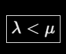
\\[ \boxed{\lambda < \mu} \\]

The arrival rate must be less than the service rate. Otherwise, the queue will keep growing and a stable system will not exist.

## **5. Important Formulas of M/M/1 Queue**

These formulas are very important for numerical problems.

**1. Server Utilization**
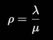
\\[ \rho = \frac{\lambda}{\mu} \\]

It represents the percentage of time the server is busy.

**2. Probability that the system is empty**
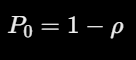
\\[ P_0 = 1-\rho \\]

**3. Average number of customers in the system**
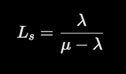
\\[ L_s = \frac{\lambda}{\mu-\lambda} \\]

**4. Average number of customers in the queue**
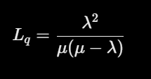
\\[ L_q = \frac{\lambda^2}{\mu(\mu-\lambda)} \\]

**5. Average time spent in the system**
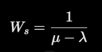
\\[ W_s = \frac{1}{\mu-\lambda} \\]

**6. Average waiting time in the queue**
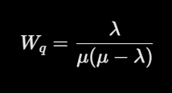
\\[ W_q = \frac{\lambda}{\mu(\mu-\lambda)} \\]

## **6. Numerical Example**

**Question:** Customers arrive at a service counter at an average rate of 4 customers per hour. The server can serve 6 customers per hour. Calculate:

1. Server utilization
2. Probability that the system is empty
3. Average number of customers in the system
4. Average number of customers in the queue
5. Average time spent in the system
6. Average waiting time in the queue

**Given:**

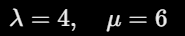

Since λ is less than μ, the system is stable.
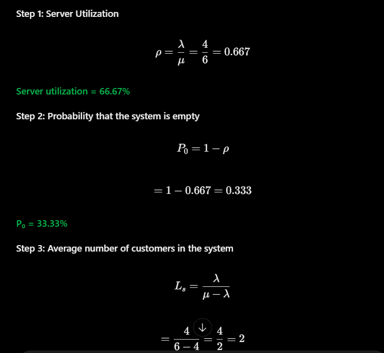
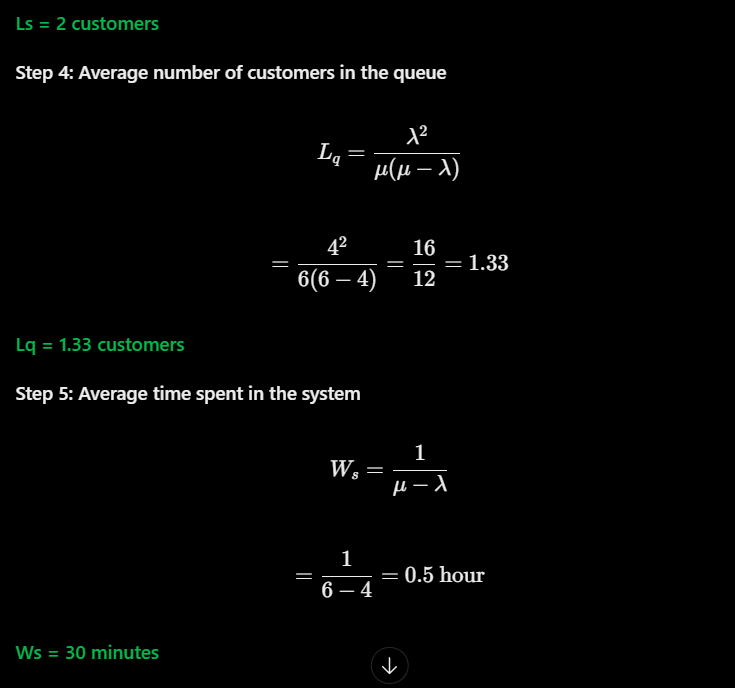
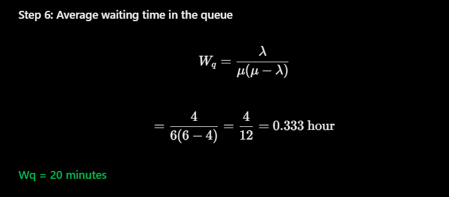

## **7. Final Answer Summary**

| Parameter                        | Result           |
| -------------------------------- | ---------------- |
| Arrival rate (λ)                 | 4 customers/hour |
| Service rate (μ)                 | 6 customers/hour |
| Utilization (ρ)                  | 66.67%           |
| Empty system probability (P₀)    | 33.33%           |
| Average customers in system (Ls) | 2                |
| Average customers in queue (Lq)  | 1.33             |
| Average time in system (Ws)      | 30 minutes       |
| Average waiting time (Wq)        | 20 minutes       |

## **8. Applications of M/M/1 Queue**

1. **Banks:** A single counter serving customers.
2. **Computer systems:** A single processor handling incoming jobs.
3. **Networks:** A single communication channel processing packets.
4. **Hospitals:** A single service desk handling patients.
5. **Ticket counters:** One counter serving people in a queue.

## **9. Quick Revision 📝**

- M/M/1 = Poisson arrivals + Exponential service + One server.
- λ = Arrival rate.
- μ = Service rate.
- ρ = λ/μ.
- Stability condition = λ less than μ.
- Ls = Average customers in the system.
- Lq = Average customers waiting in the queue.
- Ws = Average time in the system.
- Wq = Average waiting time in the queue.

**Important relationship to remember:**
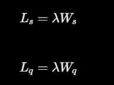
These are called Little's Law relationships.

## **Important Exam Questions**

1. Define M/M/1 queue and explain its assumptions.
2. Explain the characteristics of an M/M/1 queuing model.
3. Derive or write the important formulas of an M/M/1 queue.
4. Explain server utilization and probability of an empty system.
5. Solve a numerical problem based on M/M/1 queue.
6. Differentiate between Ls, Lq, Ws and Wq.

**Exam tip:** Memorize the six main formulas and practice at least one numerical problem. Most M/M/1 numerical questions ask you to calculate utilization, average queue length and waiting time.