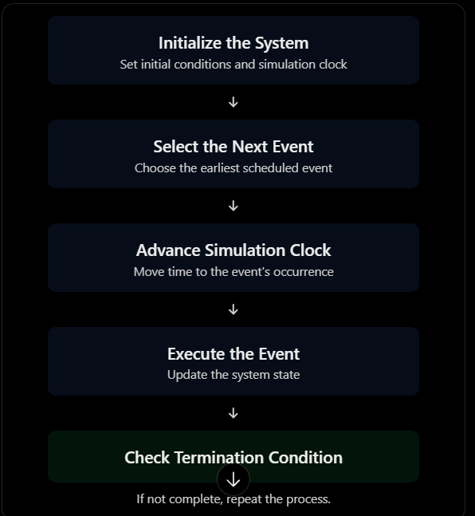

## **Module IV – Syllabus**

**Discrete-Event Simulation**

Starting now

1. Discrete-Event Simulation
2. Components of a Simulation Model
3. Organization of a Simulation Model
4. Determining Events and Variables
5. Approaches for Time Advance
6. Generation of Arrival Patterns
7. Simulation Programming Tasks
8. Gathering Statistics
9. Occupancy and Utilization
10. Recording Distributions
11. Transit Times

## **Topic 1: Discrete-Event Simulation**

### **1. Definition**

Discrete-Event Simulation (DES) is a simulation technique in which the state of a system changes only at specific points in time called **events**.

An event is an occurrence that changes the condition or state of a system.

**Example:** Consider a bank:

- A customer arrives.
- The customer joins the queue.
- The cashier starts serving the customer.
- The customer leaves the bank.

Each of these activities is an event that changes the system's state.

### **2. How does it work?**

Discrete-event simulation works by processing events in chronological order (according to their scheduled time).

### **3. Important Characteristics**

1. **Event-Based:** The system changes when an event occurs.
2. **Simulation Clock:** Maintains the current simulated time.
3. **Event Scheduling:** Events are arranged according to their occurrence time.
4. **State Changes:** Each event may change the system's condition.
5. **Time Advancement:** The clock moves from one event to the next.
6. **Statistics Collection:** Data such as waiting time, queue length and resource utilization are recorded.

### **4. Types of Events**

In a queue-based system, two common events are:

- **Arrival Event:** Occurs when a new customer or job enters the system.
- **Departure Event:** Occurs when a customer or job completes service and leaves the system.

Other examples include service completion, machine failure and machine repair.

### **5. Applications**

- **Banking:** Simulating customer arrivals and waiting lines.
- **Computer Networks:** Simulating packet arrival and transmission.
- **Operating Systems:** Simulating process scheduling.
- **Manufacturing:** Simulating production lines and machine operations.
- **Hospitals:** Simulating patient arrivals and treatment.

### **6. Advantages**

- Helps analyze complex systems.
- Identifies bottlenecks and delays.
- Allows testing without disturbing the real system.
- Helps improve resource utilization.
- Supports decision-making and planning.

### **Hinglish Explanation**

Discrete-Event Simulation mein system continuously change nahi hota. System ki state sirf tab change hoti hai jab koi event occur hota hai.

For example, bank mein customer ka aana, service start hona aur customer ka chale jaana — ye sab events hain. Simulation clock ek event se next event ke time par move karta hai.

## **Exam-ready answer: What is Discrete-Event Simulation?**

Discrete-Event Simulation is a simulation technique in which the state of a system changes only at specific points in time called events. Events are processed in chronological order using a simulation clock.

For example, in a bank, customer arrival, service start and customer departure are events. Each event changes the state of the system.

The main characteristics of discrete-event simulation are event scheduling, simulation clock, state changes, time advancement and statistics collection. It is widely used in banking, computer networks, operating systems, manufacturing and healthcare.

**Conclusion:** Discrete-event simulation helps study and analyze systems whose states change due to specific events over time.

**Next topic:** Components of a Simulation Model.

We'll understand each component with a simple example before moving ahead.