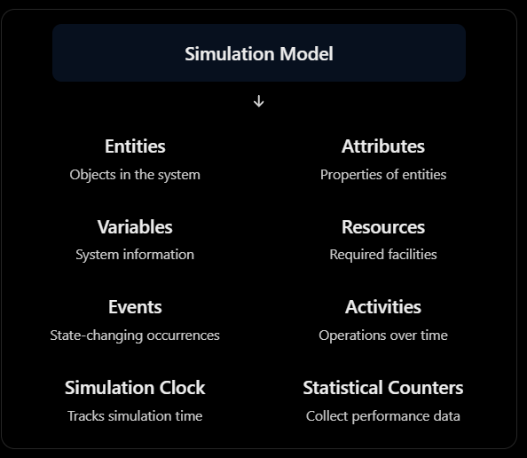

# **Module IV – Topic 2: Components of a Simulation Model**

## **1. Introduction**

A simulation model represents the working of a real-world system. It consists of different components that describe the system, its activities, changes and behaviour over time.

These components help us understand how a system operates and how it responds to different situations.

**Example:** In a bank simulation, customers arrive, wait in a queue, receive service from a cashier and then leave. All these activities are represented using components of a simulation model.

## **2. Main Components of a Simulation Model**

The important components are:

### **1. Entities**

Entities are the objects or individuals that move through or interact with a system.

- They are the main objects being studied in a simulation.
- Entities may be temporary or permanent.

**Example:** Customers in a bank, packets in a network and products in a factory.

### **2. Attributes**

Attributes are the properties or characteristics associated with an entity.

- They describe individual entities.
- Different entities can have different attribute values.

**Example:** A bank customer's ID, arrival time and service time.

### **3. Variables**

Variables represent information about the overall system. Their values may change during simulation.

- They describe the current condition of the system.
- They are not necessarily associated with a single entity.

**Example:** Number of customers in a queue, total completed services and current simulation time.

### **4. Resources**

Resources are facilities or objects required by entities to perform certain activities.

- Resources may have limited availability.
- Entities may need to wait if resources are busy.

**Example:** Cashiers in a bank, machines in a factory and processors in a computer system.

### **5. Events**

An event is an occurrence that causes a change in the state of a system.

- Events happen at specific points in simulation time.
- They can change variables, entity status or resource availability.

**Example:** Customer arrival, service completion and machine failure.

### **6. Activities**

Activities are operations or tasks performed in a system over a period of time.

- They consume simulation time.
- They may require resources.

**Example:** Serving a customer, processing a packet and manufacturing a product.

### **7. Simulation Clock**

The simulation clock represents the current time in the simulated system.

- It keeps track of the progress of simulation.
- In discrete-event simulation, it advances from one event time to the next.

**Example:** If the next event is scheduled at time 10, the simulation clock advances to 10.

### **8. Statistical Counters**

Statistical counters collect information about the performance of a system during simulation.

- They help measure system efficiency.
- They are used to analyze simulation results.

**Example:** Average waiting time, total customers served, resource utilization and average queue length.

## **3. Diagram of Components**

## **4. Example: Bank Simulation Model**

| Component           | Bank example                  |
| ------------------- | ----------------------------- |
| Entity              | Customer                      |
| Attribute           | Customer ID, arrival time     |
| Variable            | Number of customers waiting   |
| Resource            | Cashier                       |
| Event               | Customer arrival or departure |
| Activity            | Customer service              |
| Simulation clock    | Current simulated time        |
| Statistical counter | Average waiting time          |

This example shows how different components work together to represent a real banking system.

## **5. Advantages of These Components**

1. They help represent real-world systems clearly.
2. They make simulation models easier to understand.
3. They help identify system problems and bottlenecks.
4. They help measure system performance.
5. They support better analysis and decision-making.

## **Hinglish Explanation**

Ek simulation model ko banane ke liye kuch basic components ki zarurat hoti hai:

- **Entity:** System mein kaam karne wali object, jaise customer.
- **Attribute:** Entity ki information, jaise customer ID.
- **Variable:** Puri system ki changing information, jaise queue mein kitne customers hain.
- **Resource:** Kaam karne ke liye required facility, jaise cashier.
- **Event:** Koi incident jo system ko change kare, jaise customer arrival.
- **Activity:** Koi task jo time leta hai, jaise customer service.
- **Simulation Clock:** Simulation ka current time.
- **Statistical Counters:** Performance calculate karne ke liye, jaise average waiting time.

## **Quick Revision**

| Component           | One-line meaning                     |
| ------------------- | ------------------------------------ |
| Entity              | Object being simulated               |
| Attribute           | Property of an entity                |
| Variable            | Changing system information          |
| Resource            | Facility required for work           |
| Event               | Occurrence that changes system state |
| Activity            | Operation that takes time            |
| Simulation Clock    | Tracks simulation time               |
| Statistical Counter | Measures system performance          |

Exam tip

&#x20;Learn all 8 components with the bank example. This is a good structure for a 10-mark question.

**Next topic: Organization of a Simulation Model.**