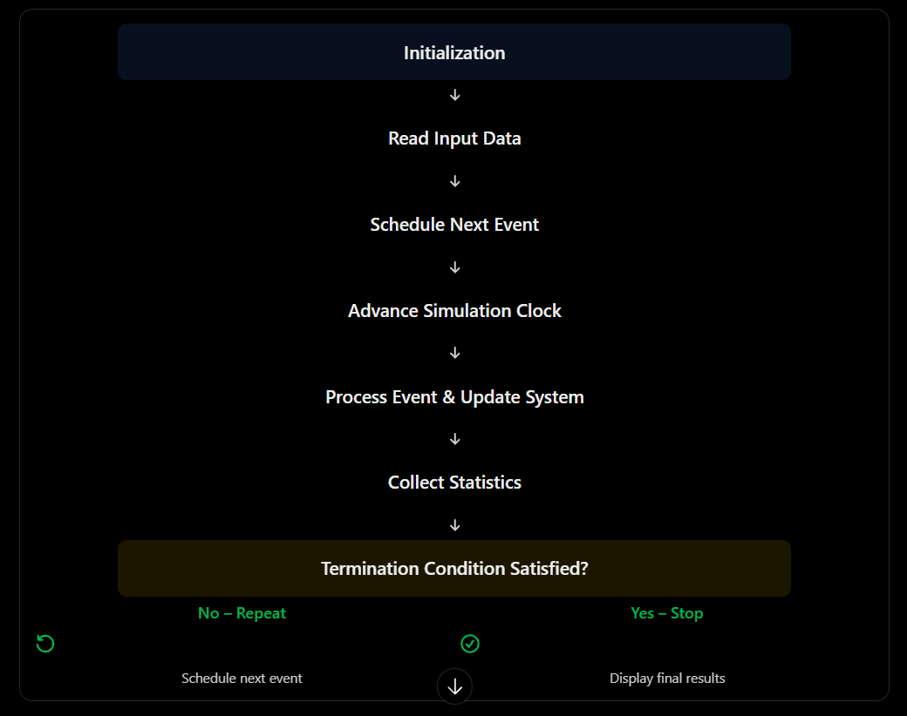

# **Module IV – Topic 3: Organization of a Simulation Model**

## **1. Introduction**

The organization of a simulation model refers to the way different parts of a simulation program are arranged and connected to represent the working of a real-world system.

A properly organized simulation model helps us understand the system, process events in the correct order, update system conditions and collect performance statistics.

**Example:** In a bank simulation, the model must organize customer arrivals, queue formation, cashier service and customer departures in a proper sequence.

## **2. Main Parts of a Simulation Model**

A simulation model is generally organized into the following parts:

### **1. Initialization**

- Initialization is the first step of a simulation model.
- It sets the initial values of variables, simulation clock, resources and statistical counters.

**Example:** Set simulation time to 0, number of customers to 0 and cashier status to idle.

### **2. Input Data**

- Input data provides the information required to run the simulation.
- It may include arrival times, service times and other system parameters.

**Example:** Customer arrival intervals and the time required to serve each customer.

### **3. Event Scheduling**

- Events are arranged according to their scheduled occurrence time.
- The simulation selects the next event to be processed.

**Example:** Customer arrival at time 2 and service completion at time 5.

### **4. Event Processing**

- The selected event is executed.
- The system state is updated according to the event.

**Example:** When a customer arrives, the number of customers in the system increases by one.

### **5. Time Advancement**

- The simulation clock moves forward to the time of the next scheduled event.
- In discrete-event simulation, time usually advances from one event to another.

### **6. Statistics Collection**

- Important performance information is collected during simulation.
- It helps evaluate the efficiency of the system.

**Example:** Average waiting time, queue length and cashier utilization.

### **7. Termination**

- The simulation stops when a specified termination condition is satisfied.
- The final statistics and results are displayed.

**Example:** Stop the simulation after serving 100 customers or completing 8 simulated hours.

## **3. Flowchart of Simulation Model Organization**

## **4. Example: Organization of a Bank Simulation**

Consider a bank with one cashier.

1. **Initialization:** Set the clock to 0 and cashier status to idle.
2. **Input:** Read customer arrival and service times.
3. **Event Scheduling:** Schedule customer arrival and service completion events.
4. **Event Processing:** When a customer arrives, check whether the cashier is free.
5. **Time Advancement:** Move the simulation clock to the next event time.
6. **Statistics Collection:** Record customer waiting time and cashier busy time.
7. **Termination:** Stop after the required number of customers have been served.

## **5. Advantages**

- Provides a systematic structure for simulation programs.
- Makes the simulation easier to develop and understand.
- Helps process events in the correct sequence.
- Makes it easier to identify errors.
- Helps collect and analyze performance data.

## **Hinglish Explanation**

Simulation model ko organize karne ka matlab hai simulation program ke different steps ko proper order mein arrange karna.

Iske main steps hain:

1. **Initialization:** Starting values set karna.
2. **Input Data:** Required data lena.
3. **Event Scheduling:** Events ka time decide karna.
4. **Event Processing:** Event execute karke system update karna.
5. **Time Advancement:** Clock ko next event ke time par le jaana.
6. **Statistics Collection:** Waiting time aur utilization calculate karna.
7. **Termination:** Condition complete hone par simulation stop karna.

**Easy example:** Bank mein pehle customer aayega, phir queue mein wait karega, cashier service dega aur customer exit karega. Simulation model in sab steps ko proper order mein manage karta hai.

## **Quick Revision**

| Part                  | Main purpose                 |
| --------------------- | ---------------------------- |
| Initialization        | Set initial conditions       |
| Input Data            | Provide required information |
| Event Scheduling      | Arrange future events        |
| Event Processing      | Execute events               |
| Time Advancement      | Move simulation clock        |
| Statistics Collection | Record performance           |
| Termination           | Stop simulation              |

Exam tip

&#x20;This topic is suitable for a 10-mark answer. Remember the seven steps and practice the flowchart.

**Next topic: Determining Events and Variables.**