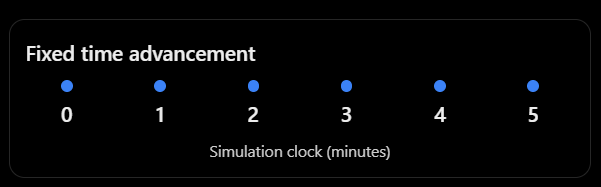
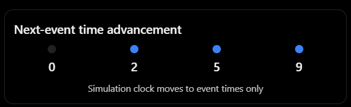

# **Module IV – Topic 5: Approaches for Time Advance**

## **1. Introduction**

In discrete-event simulation, the simulation clock represents the current time of the simulated system.

**Time Advance** is the process of moving the simulation clock forward during simulation.

There are two main approaches for time advancement:

1. Fixed Time Increment Approach (Time-Driven Approach)
2. Next Event Time Advance Approach (Event-Driven Approach)

## **2. Fixed Time Increment Approach**

This approach is also known as the **Time-Driven Approach**.

- In this method, simulation time advances by a fixed interval.
- The system is checked at every time interval to identify whether any event has occurred.
- If an event occurs, the system state is updated.

**Example:**

Suppose a simulation uses a time interval of 1 minute.

The simulation clock advances as follows:

**Fixed time advancement**

The clock moves from 0 to 1, 1 to 2, 2 to 3, and so on.

**Advantages:**

- Simple to understand and implement.
- Useful when events occur at regular intervals.
- Easy to observe system behaviour at fixed time intervals.

**Disadvantages:**

- Time may be wasted checking intervals when no event occurs.
- Small time intervals require more computation.
- Large time intervals may miss important event details or timing.

## **3. Next Event Time Advance Approach**

This approach is also known as the **Event-Driven Approach** or **Next Event Scheduling**.

- In this method, the simulation clock advances directly to the time of the next scheduled event.
- The system does not check every fixed time interval.
- Only the events scheduled to occur are processed.

**Example:**

Suppose events are scheduled at times 2, 5 and 9.

**Next-event time advancement**

The simulation clock moves:

- From 0 to 2 (first event).
- From 2 to 5 (second event).
- From 5 to 9 (third event).

**Advantages:**

- Avoids unnecessary time checking.
- More efficient for systems with irregular events.
- Commonly used in discrete-event simulation.

**Disadvantages:**

- Requires maintaining an event list.
- Event scheduling and management can be complex.
- Simultaneous events need proper handling.

## **4. Difference Between Both Approaches**

| Fixed Time Increment                     | Next Event Time Advance                     |
| ---------------------------------------- | ------------------------------------------- |
| Time advances by fixed intervals.        | Time advances to the next event.            |
| Checks the system at every interval.     | Processes scheduled events only.            |
| May perform unnecessary checks.          | Avoids unnecessary checks.                  |
| Easier to implement.                     | Requires event scheduling.                  |
| Suitable for regular time-based changes. | Suitable for irregular event-based changes. |
| Also called time-driven.                 | Also called event-driven.                   |

## **5. Applications**

- **Banking:** Moving simulation time to customer arrival and service completion.
- **Computer Networks:** Processing packet arrival and transmission events.
- **Manufacturing:** Simulating machine operations and breakdowns.
- **Operating Systems:** Simulating process arrival and completion.

## **Hinglish Explanation**

Time Advance ka matlab hai simulation ke clock ko aage badhana.

Iske do approaches hain:

**1. Fixed Time Increment:** Clock fixed interval se aage badhta hai. Jaise 0, 1, 2, 3, 4, 5 minutes. Har interval par system check hota hai ki koi event hua hai ya nahi.

**2. Next Event Time Advance:** Clock directly next event ke time par jump karta hai. Jaise events 2, 5 aur 9 par hain, toh clock 0 → 2 → 5 → 9 move karega.

**Easy trick:**

- Fixed approach = Har interval par check.
- Next event approach = Sirf event hone par time advance.

## **Quick Revision**

| Point         | Fixed Increment | Next Event             |
| ------------- | --------------- | ---------------------- |
| Time movement | Fixed steps     | Event times            |
| Other name    | Time-driven     | Event-driven           |
| Efficiency    | May waste time  | Usually more efficient |
| Event list    | Not essential   | Required               |
| Example       | 0, 1, 2, 3      | 0, 2, 5, 9             |

Exam tip

&#x20;This is an important comparison-based topic. Prepare both definitions, examples, advantages, disadvantages and the difference table.

**Next topic: Generation of Arrival Patterns.**