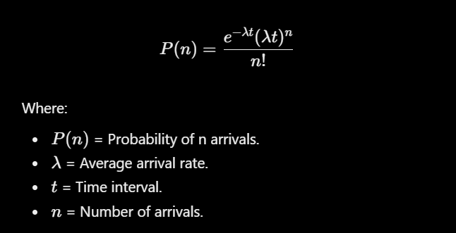
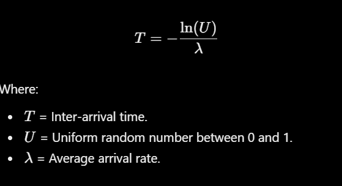
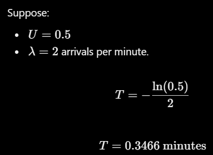

# **Module IV – Topic 6: Generation of Arrival Patterns**

## **1. Introduction**

Generation of Arrival Patterns is the process of determining how entities enter a system during a simulation.

An arrival pattern describes:

- When entities arrive.
- How frequently they arrive.
- How much time passes between consecutive arrivals.

**Example:** In a bank, customers arrive at different times. Some customers may arrive after 2 minutes, while others may arrive after 5 minutes.

In simulation, arrival patterns help represent the actual behaviour of customers, jobs, packets or other entities.

## **2. Types of Arrival Patterns**

### **1. Deterministic Arrival Pattern**

- In this pattern, entities arrive at fixed and regular time intervals.
- The time between consecutive arrivals remains constant.

**Example:** A bus arrives at a bus stop every 10 minutes.

If the first customer arrives at time 0, the arrival times are:

| Customer | Arrival time |
| -------- | ------------ |
| C1       | 0            |
| C2       | 5            |
| C3       | 10           |
| C4       | 15           |
| C5       | 20           |

Here, the inter-arrival time is always 5 minutes.

### **2. Random or Stochastic Arrival Pattern**

- In this pattern, entities arrive at irregular and unpredictable time intervals.
- Arrival times are generated using probability distributions.

**Example:** Customers arriving at a shopping mall or packets arriving at a computer network.

| Customer | Inter-arrival time | Arrival time |
| -------- | ------------------ | ------------ |
| C1       | –                  | 0            |
| C2       | 2                  | 2            |
| C3       | 4                  | 6            |
| C4       | 1                  | 7            |
| C5       | 3                  | 10           |

Here, inter-arrival times are different.

### **3. Poisson Arrival Pattern**

- It is a commonly used random arrival model in simulation.
- It assumes that arrivals occur independently at an average constant rate.
- The time between consecutive arrivals follows an exponential distribution.

The Poisson probability formula is:

Where:

- \\(P(n)\\) = Probability of n arrivals.
- \\(\lambda\\) = Average arrival rate.
- \\(t\\) = Time interval.
- \\(n\\) = Number of arrivals.

**Example:** If customers arrive at an average rate of 4 customers per hour, the Poisson distribution can be used to estimate the probability of a particular number of arrivals in one hour.

## **3. Generation of Random Arrival Times**

Random arrival times can be generated using random numbers.

For an exponential inter-arrival time distribution, the formula is:

**Example:**

Therefore, the next arrival occurs approximately 0.347 minutes after the previous arrival.

## **4. Methods Used to Generate Arrival Patterns**

1. **Fixed Interval Method:** Entities arrive after a constant time interval.
2. **Probability Distribution Method:** Arrival times are generated using distributions such as exponential distribution.
3. **Random Number Method:** Random numbers are used to generate different arrival intervals.
4. **Historical Data Method:** Actual arrival records are used to represent real-world arrival behaviour.

## **5. Applications**

- **Banking:** Generating customer arrival times.
- **Computer Networks:** Generating incoming packet arrival times.
- **Hospitals:** Simulating patient arrivals.
- **Manufacturing:** Generating job arrivals at production units.
- **Airports:** Simulating passenger arrivals.

## **6. Advantages**

- Represents real-world arrival behaviour.
- Helps analyze waiting times and queue lengths.
- Helps identify congestion and bottlenecks.
- Improves the accuracy of simulation models.
- Helps in planning system resources.

## **Hinglish Explanation**

Generation of Arrival Patterns ka matlab hai simulation mein entities kis time aur kitne interval par system mein enter karengi, ye determine karna.

Iske main types hain:

1. **Deterministic:** Fixed interval par arrival. Jaise har 5 minute mein ek customer.
2. **Random/Stochastic:** Irregular interval par arrival. Jaise kabhi 2 minute, kabhi 4 minute, kabhi 1 minute.
3. **Poisson:** Random arrivals ka mathematical model, jisme average arrival rate constant maana jaata hai aur inter-arrival time exponential distribution follow karta hai.

Random arrival time generate karne ke liye formula use hota hai:

\\[ T=-\frac{\ln(U)}{\lambda} \\]

Yahan U random number hai aur λ average arrival rate hai.

## **Quick Revision**

| Term                     | Meaning                                                   |
| ------------------------ | --------------------------------------------------------- |
| Arrival Pattern          | How entities enter a system                               |
| Deterministic            | Fixed arrival intervals                                   |
| Stochastic               | Random arrival intervals                                  |
| Poisson                  | Random arrivals at a constant average rate                |
| Inter-arrival Time       | Time between two consecutive arrivals                     |
| Exponential Distribution | Common model for inter-arrival times in a Poisson process |

Exam tip

&#x20;Focus on deterministic and random arrival patterns, Poisson arrivals, and the exponential inter-arrival time formula. These are the most important points for a 10-mark answer.

**Next topic: Simulation Programming Tasks.**