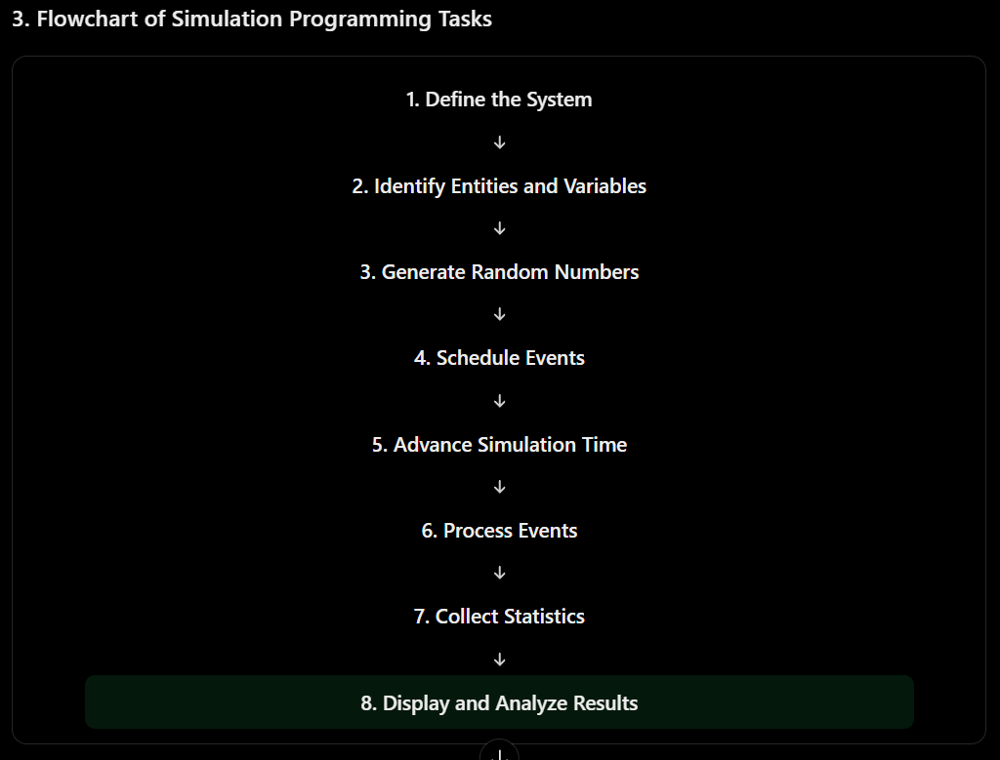

# **Module IV – Topic 7: Simulation Programming Tasks**

## **1. Introduction**

Simulation Programming Tasks are the activities performed while developing and executing a simulation program.

These tasks help create a simulation model, execute it, collect data and analyze the results.

**Example:** To simulate a bank, we need to write a program that generates customer arrivals, manages the waiting queue, provides service and records customer waiting times.

## **2. Important Simulation Programming Tasks**

### **1. Defining the System**

- Understand the real-world system that needs to be simulated.
- Identify its components, operations and working conditions.

**Example:** Defining a bank with customers, a queue and one cashier.

### **2. Defining Variables and Entities**

- Identify the entities, attributes and variables required in the simulation.
- These represent the objects and changing conditions of the system.

**Example:** Customer arrival time, service time and queue length.

### **3. Generating Random Numbers**

- Generate random numbers to represent uncertain activities.
- These numbers help simulate random arrival and service times.

**Example:** Generating random customer arrival intervals.

### **4. Scheduling Events**

- Identify and schedule events according to their occurrence time.
- Maintain an event list to process events in the correct order.

**Example:** Scheduling customer arrival and service completion.

### **5. Advancing Simulation Time**

- Update the simulation clock during execution.
- In discrete-event simulation, the clock generally advances to the next scheduled event.

**Example:** Moving the clock from 2 minutes to 5 minutes when the next event is scheduled at time 5.

### **6. Processing Events**

- Execute events when their scheduled time arrives.
- Update the system state according to the event.

**Example:** When a customer arrives, increase the number of customers in the system.

### **7. Collecting Statistics**

- Record important information during simulation.
- Calculate performance measures to evaluate the system.

**Example:** Average waiting time, queue length and server utilization.

### **8. Displaying and Analyzing Results**

- Display the final simulation results.
- Analyze the results to understand system performance and identify problems.

**Example:** Finding whether a bank needs another cashier to reduce waiting time.

## **3. Flowchart of Simulation Programming Tasks**

## **4. Example: Bank Simulation**

Consider a bank with one cashier.

| Programming task        | Bank simulation example        |
| ----------------------- | ------------------------------ |
| Define system           | Bank with one cashier          |
| Define entities         | Customers                      |
| Define variables        | Queue length, waiting time     |
| Generate random numbers | Customer arrival intervals     |
| Schedule events         | Arrival and service completion |
| Advance time            | Move to next event             |
| Process events          | Serve and release customers    |
| Collect statistics      | Average waiting time           |
| Analyze results         | Check cashier performance      |

## **5. Importance of Simulation Programming Tasks**

1. Helps develop an organized simulation program.
2. Represents real-world system behaviour.
3. Handles random and uncertain activities.
4. Helps track events and system changes.
5. Collects useful performance information.
6. Helps identify bottlenecks and improve efficiency.

## **Hinglish Explanation**

Simulation Programming Tasks ka matlab hai simulation program banane aur execute karne ke liye kiye jaane wale different tasks.

For example, bank simulation banate waqt:

1. Bank ka system define karna.
2. Customers aur variables identify karna.
3. Random arrival times generate karna.
4. Events schedule karna.
5. Simulation clock advance karna.
6. Events execute karna.
7. Waiting time aur utilization calculate karna.
8. Final results display aur analyze karna.

**Easy trick:** Define → Identify → Generate → Schedule → Advance → Process → Collect → Analyze.

## **Quick Revision**

| Task                     | Purpose                  |
| ------------------------ | ------------------------ |
| System Definition        | Understand the system    |
| Entity Identification    | Identify objects         |
| Variable Definition      | Track system information |
| Random Number Generation | Represent uncertainty    |
| Event Scheduling         | Arrange events           |
| Time Advancement         | Update simulation clock  |
| Event Processing         | Execute events           |
| Statistics Collection    | Record performance       |
| Result Analysis          | Evaluate the system      |

Exam tip

&#x20;For a 10-mark answer, explain the eight main tasks with the bank example and draw the flowchart.

**Next topic: Gathering Statistics.**