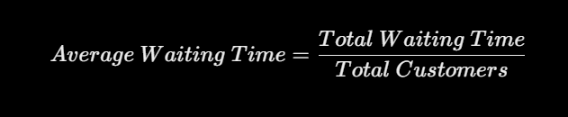
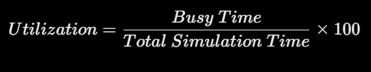
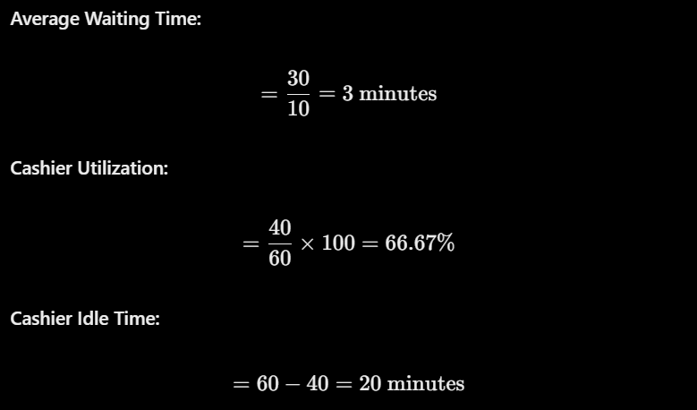

# **Module IV – Topic 8: Gathering Statistics**

## **1. Introduction**

Gathering Statistics is the process of collecting and recording important information during a simulation to measure the performance of a system.

It helps us understand how efficiently a system works and identify problems such as long waiting times, resource wastage and congestion.

**Example:** In a bank simulation, we collect information about the number of customers served, average waiting time and cashier utilization.

## **2. Types of Statistics Collected in Simulation**

### **1. Waiting Time**

- Waiting time is the time an entity spends waiting before receiving service.
- It helps measure delays in a system.

**Example:** If a customer arrives at 10:00 AM and receives service at 10:05 AM, the waiting time is 5 minutes.

### **2. Service Time**

- Service time is the time required to complete the service of an entity.
- It helps measure how quickly a resource performs its work.

### **3. Queue Length**

- Queue length represents the number of entities waiting for service at a particular time.
- It helps identify congestion in the system.

**Example:** If 5 customers are waiting in a bank, the queue length is 5.

### **4. Average Waiting Time**

- It represents the average time spent waiting by all entities.
- It helps evaluate the efficiency of a service system.

### **5. Resource Utilization**

- Resource utilization measures how much time a resource remains busy compared to the total available simulation time.
- It helps determine whether resources are being used efficiently.

### **6. Throughput**

- Throughput is the total number of entities successfully processed during a given period.
- It measures the processing capacity of a system.

**Example:** If a bank serves 50 customers in one hour, its throughput is 50 customers per hour.

### **7. Idle Time**

- Idle time is the period during which a resource remains unused.
- It helps identify resource wastage.

## **3. Methods of Gathering Statistics**

1. **Counters:** Used to count events, such as the total number of customers served.
2. **Accumulators:** Used to calculate totals, such as total waiting time.
3. **Time-Based Recording:** Used to record how long a system remains in a particular state.
4. **Frequency Distribution:** Used to record how frequently different values occur.
5. **Average Calculation:** Used to calculate average waiting time, service time and queue length.

## **4. Example: Gathering Statistics in a Bank**

Suppose a bank operates for 60 minutes and serves 10 customers.

- Total waiting time = 30 minutes.
- Total service time = 40 minutes.
- Cashier busy time = 40 minutes.
- Total simulation time = 60 minutes.

**Average Waiting Time:**

Therefore, the average customer waiting time is 3 minutes and cashier utilization is 66.67%.

## **5. Importance of Gathering Statistics**

1. Helps measure system performance.
2. Identifies bottlenecks and delays.
3. Measures resource utilization.
4. Helps compare different system designs.
5. Supports better planning and decision-making.
6. Helps improve overall system efficiency.

## **Hinglish Explanation**

Gathering Statistics ka matlab hai simulation ke dauraan important data collect karna, taaki pata chal sake ki system kitna efficiently work kar raha hai.

Bank example mein hum collect karenge:

- **Waiting Time:** Customer ne kitni der wait kiya.
- **Service Time:** Customer ko service dene mein kitna time laga.
- **Queue Length:** Kitne customers line mein hain.
- **Utilization:** Cashier kitne time busy raha.
- **Throughput:** Total kitne customers serve hue.
- **Idle Time:** Cashier kitne time free raha.

Ye statistics help karte hain identify karne mein ki system mein delay ya resource wastage kahan ho raha hai.

## **Quick Revision**

| Statistic            | Meaning                      |
| -------------------- | ---------------------------- |
| Waiting Time         | Time spent waiting           |
| Service Time         | Time spent receiving service |
| Queue Length         | Number of waiting entities   |
| Average Waiting Time | Average delay                |
| Resource Utilization | Percentage of busy time      |
| Throughput           | Total entities processed     |
| Idle Time            | Time resource remains free   |

Exam tip

&#x20;Learn the definitions and formulas of average waiting time, resource utilization and idle time. Numerical examples can make your 10-mark answer stronger.

**Next topic: Occupancy and Utilization.**