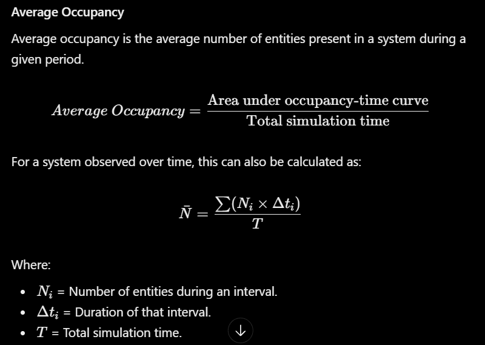
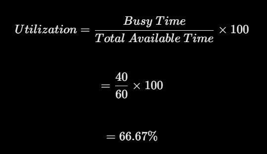
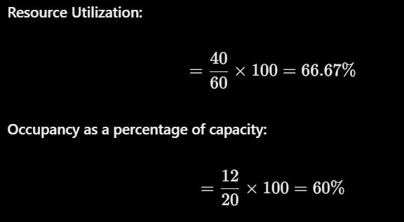
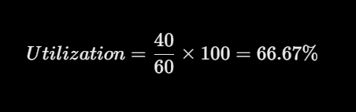

# **Module IV – Topic 9: Occupancy and Utilization**

## **1. Introduction**

Occupancy and Utilization are important performance measures used in simulation to evaluate how effectively resources are being used in a system.

They help determine how much of the available capacity is occupied and how efficiently resources are working.

**Example:** In a bank, occupancy tells us how many customers are present in the system, while utilization tells us how much time the cashier remains busy.

## **2. Occupancy**

Occupancy refers to the number of entities or the amount of system capacity occupied at a particular time.

- It indicates how much of a system is currently occupied.
- It helps measure the load on a system.
- It can be measured over time to calculate average occupancy.

**Example:** If a bank has a maximum capacity of 20 customers and currently 12 customers are present, the occupancy is 12 customers.

### **Average Occupancy**

Average occupancy is the average number of entities present in a system during a given period.

## **3. Utilization**

Utilization measures the percentage of time a resource remains busy compared to its total available time.

- It indicates how efficiently a resource is being used.
- It helps identify underused or overloaded resources.

**Example:** If a cashier works for 40 minutes during a 60-minute simulation, the utilization is:

Therefore, the cashier utilization is 66.67%.

## **4. Types of Utilization**

### **1. Resource Utilization**

Measures how much time a resource remains busy.

**Example:** Percentage of time a cashier or machine is working.

### **2. System Utilization**

Measures how much of the overall system capacity is being used.

**Example:** Percentage of occupied seats in a waiting area.

## **5. Difference Between Occupancy and Utilization**

| Occupancy                                              | Utilization                                          |
| ------------------------------------------------------ | ---------------------------------------------------- |
| Measures the number of entities or capacity occupied.  | Measures how much a resource is used.                |
| Indicates the current system load.                     | Indicates resource efficiency.                       |
| Can be measured in entities or percentage of capacity. | Usually expressed as a percentage of available time. |
| Example: 12 customers in a bank.                       | Example: Cashier busy 66.67% of the time.            |

## **6. Example: Bank Simulation**

Suppose a bank has:

- Total simulation time = 60 minutes.
- Cashier busy time = 40 minutes.
- Maximum customer capacity = 20.
- Average number of customers present = 12.

Therefore:

- Average occupancy = 12 customers.
- Occupancy percentage = 60%.
- Cashier utilization = 66.67%.

## **7. Importance of Occupancy and Utilization**

1. Helps measure system performance.
2. Identifies underused and overloaded resources.
3. Helps improve resource allocation.
4. Reduces waiting time and operational delays.
5. Supports better planning and decision-making.

## **Hinglish Explanation**

Occupancy aur Utilization dono system performance measure karne ke liye use hote hain, lekin dono ka meaning different hai.

**Occupancy:** System mein kitne entities ya customers present hain.

Example: Bank mein total capacity 20 customers ki hai aur currently 12 customers hain, toh occupancy 12 customers hai.

**Utilization:** Resource kitne time tak busy raha.

Example: Cashier 60 minutes mein 40 minutes busy raha:

**Easy trick:**

- Occupancy = Kitni jagah ya capacity occupied hai?
- Utilization = Resource kitne time busy hai?

## **Quick Revision**

| Term                 | Formula / Meaning                              |
| -------------------- | ---------------------------------------------- |
| Occupancy            | Number of entities or capacity occupied        |
| Average Occupancy    | Area under occupancy-time curve ÷ Total time   |
| Utilization          | Busy Time ÷ Available Time × 100               |
| Resource Utilization | Percentage of time a resource is busy          |
| System Utilization   | Percentage of total system capacity being used |

Exam tip

&#x20;This topic is important for numerical and theory questions. Remember the difference between occupancy and utilization, along with their formulas and the bank example.

**Next topic: Recording Distributions.**