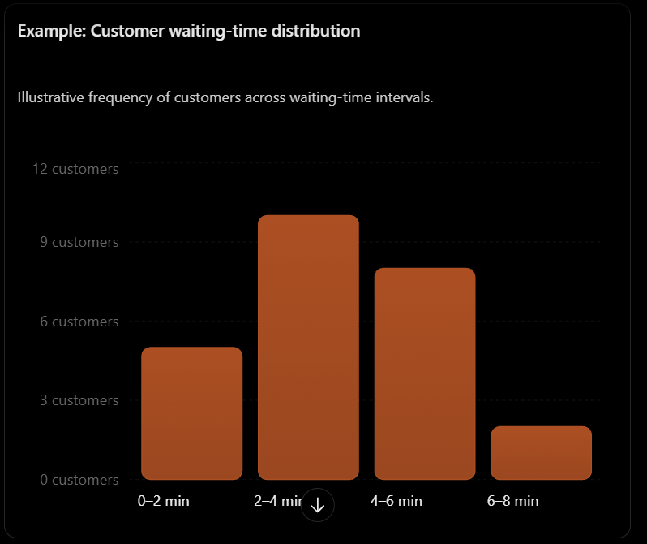
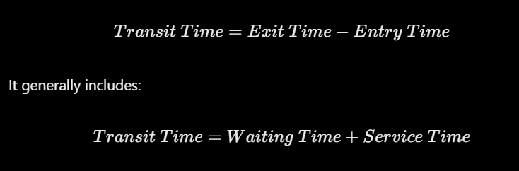
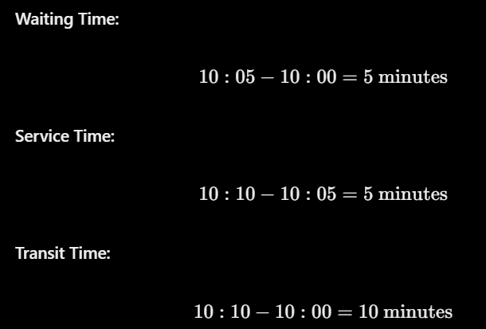
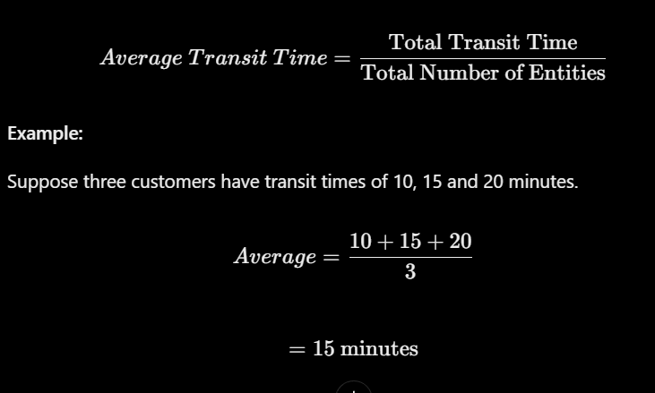
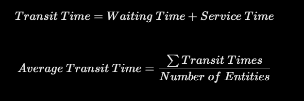

# **Module IV – Topic 10 & 11: Recording Distributions and Transit Times**

These are the final two topics of Module IV. Let's understand them separately with definitions, examples and formulas.

# **Part A: Recording Distributions**

## **1. Introduction**

Recording Distributions is the process of collecting and recording the frequency of different values obtained during a simulation.

It helps understand how frequently a particular event or value occurs and how simulation results are distributed.

**Example:** In a bank simulation, we can record how many customers wait for 1 minute, 2 minutes, 3 minutes or more.

## **2. Purpose of Recording Distributions**

1. To understand the behaviour of a simulated system.
2. To record the frequency of different values.
3. To analyze waiting times and service times.
4. To identify common and uncommon outcomes.
5. To compare simulation results with expected results.

## **3. Methods of Recording Distributions**

### **1. Frequency Distribution**

- Records how many times a particular value or range of values occurs.
- Results are organized into groups or intervals.

**Example:**

| Waiting time (minutes) | Number of customers |
| ---------------------- | ------------------- |
| 0–2                    | 5                   |
| 2–4                    | 10                  |
| 4–6                    | 8                   |
| 6–8                    | 2                   |

This table shows how customer waiting times are distributed.

### **2. Histogram**

- A histogram is a graphical representation of a frequency distribution.
- It uses bars to show the frequency of values within different intervals.

**Example: Customer waiting-time distribution**

### **3. Cumulative Frequency Distribution**

- It records the total frequency up to a particular interval.
- It helps determine how many observations fall below a given value.

**Example:**

| Waiting time (minutes) | Frequency | Cumulative frequency |
| ---------------------- | --------- | -------------------- |
| 0–2                    | 5         | 5                    |
| 2–4                    | 10        | 15                   |
| 4–6                    | 8         | 23                   |
| 6–8                    | 2         | 25                   |

Here, 23 customers waited less than 6 minutes.

## **4. Applications**

- Measuring customer waiting-time distributions.
- Analyzing service-time variations.
- Studying packet delays in computer networks.
- Measuring machine processing times.
- Analyzing system performance.

## **5. Advantages**

- Makes simulation results easier to understand.
- Helps identify patterns and variations.
- Supports statistical analysis.
- Helps compare different simulation models.

### **Hinglish Explanation**

Recording Distributions ka matlab hai simulation se milne wale results ko frequency ke according record karna.

Example: Bank mein kitne customers ne 0–2 minutes wait kiya, kitne ne 2–4 minutes wait kiya.

Is data ko frequency table, histogram aur cumulative frequency table ke through represent kar sakte hain.

# **Part B: Transit Times**

## **1. Introduction**

Transit Time is the total time taken by an entity to move through a system, from its entry point to its exit point.

It is an important performance measure used to evaluate the speed and efficiency of a system.

**Example:** In a bank, the transit time of a customer is the total time from entering the bank until leaving after receiving service.

## **2. Formula for Transit Time**

Where:

- Waiting Time = Time spent waiting before service.
- Service Time = Time required to receive service.

## **3. Example of Transit Time**

Suppose a customer enters a bank at 10:00 AM.

- Arrival time = 10:00 AM
- Service starts = 10:05 AM
- Service ends = 10:10 AM
- Exit time = 10:10 AM

Therefore, the customer's total transit time is 10 minutes.

## **4. Average Transit Time**

Average transit time is the average time taken by all entities to pass through a system.

## **5. Applications of Transit Time**

1. **Banking:** Measuring the total time spent by customers.
2. **Computer Networks:** Measuring the time taken by packets to travel through a network.
3. **Manufacturing:** Measuring the time taken by a product to complete production.
4. **Hospitals:** Measuring the total time a patient spends in a treatment process.
5. **Transportation:** Measuring the time taken by vehicles to travel between locations.

## **6. Importance of Transit Time**

- Helps measure system efficiency.
- Identifies delays and bottlenecks.
- Helps improve service quality.
- Supports better resource planning.
- Helps compare different system designs.

### **Hinglish Explanation**

Transit Time ka matlab hai kisi entity ko system mein enter hone se lekar exit hone tak total kitna time laga.

Example:

- Customer bank mein 10:00 baje aaya.
- Service 10:05 baje start hui.
- Service 10:10 baje complete hui.

Toh:

- Waiting Time = 5 minutes
- Service Time = 5 minutes
- Transit Time = 10 minutes

**Easy trick:** Transit Time = Total time spent inside the system.

## **Quick Revision – Both Topics**

| Topic                   | Important point                         |
| ----------------------- | --------------------------------------- |
| Recording Distributions | Records frequency of simulation results |
| Frequency Distribution  | Shows frequency in intervals            |
| Histogram               | Graphical representation of frequency   |
| Cumulative Frequency    | Running total of frequencies            |
| Transit Time            | Exit time − Entry time                  |
| Average Transit Time    | Total transit time ÷ Number of entities |

Module IV completed

## **Important formulas to remember**

**Hinglish final revision:** Recording Distributions batata hai ki different results kitni baar occur hue, jabki Transit Time batata hai ki entity ne system ke andar total kitna time spend kiya.

Next, we can prepare **Module IV important exam questions with answers** in the same English + Hinglish format.