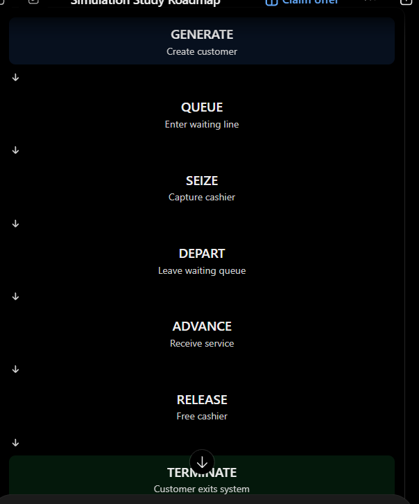

# **Module V – GPSS (General Purpose Simulation System)**

## **1. What is GPSS?**

**GPSS stands for General Purpose Simulation System.**

It is a simulation language used to create and study models of real-world systems, especially systems involving queues, waiting lines and events.

GPSS is mainly used for **discrete-event simulation**, where the system changes its state whenever an event occurs.

**Example:** We can use GPSS to simulate a bank where customers arrive, wait in a queue, receive service from a cashier and leave.

## **2. Main Features of GPSS**

1. **Easy to Use:** GPSS uses predefined blocks to represent different activities.
2. **Discrete-Event Simulation:** It models systems in which changes happen at specific points in time.
3. **Transaction-Based:** Customers, jobs or other moving objects are represented as transactions.
4. **Queue Management:** It can model waiting lines and service systems.
5. **Resource Management:** It can represent resources such as machines, servers and counters.
6. **Statistical Results:** It provides information such as waiting time, queue length and resource utilization.

## **3. Important Components of GPSS**

GPSS mainly uses the following components:

### **A. Transactions**

- A transaction represents an entity moving through a simulation model.
- It can represent a customer, product, job or data packet.
- Transactions move from one block to another during simulation.

**Example:** Every customer entering a bank is represented as a transaction.

### **B. Blocks**

- Blocks are predefined instructions that describe the activities performed by transactions.
- Each block performs a specific operation.
- Transactions move through these blocks according to the simulation logic.

**Example:** A block may represent customer arrival, queue entry or service completion.

### **C. Facilities**

- A facility represents a single resource that can serve only one transaction at a time.
- If the facility is busy, other transactions must wait.
- It is used to represent a single server or machine.

**Example:** A single cashier at a bank.

### **D. Storage**

- Storage represents a resource that can handle multiple transactions simultaneously.
- It has a fixed capacity.
- It is useful for modelling resources with multiple units.

**Example:** A parking area having 20 parking spaces.

### **E. Queues**

- A queue represents a waiting line of transactions.
- Transactions wait in the queue until the required resource becomes available.
- GPSS can collect statistics about the waiting line.

**Example:** Customers waiting outside a bank counter.

## **4. Important GPSS Blocks**

Some commonly used GPSS blocks are:

| Block     | Purpose                                   |
| --------- | ----------------------------------------- |
| GENERATE  | Creates new transactions                  |
| QUEUE     | Records entry into a queue                |
| DEPART    | Records departure from a queue            |
| SEIZE     | Captures a facility for a transaction     |
| RELEASE   | Frees a facility after service            |
| ADVANCE   | Delays a transaction for a specified time |
| TERMINATE | Removes a transaction from the simulation |

**Easy way to remember:**

- GENERATE → Create customer.
- QUEUE → Customer waits.
- SEIZE → Customer takes server.
- ADVANCE → Service takes time.
- RELEASE → Customer frees server.
- DEPART → Customer leaves waiting queue.
- TERMINATE → Customer exits simulation.

## **5. Working of GPSS – Example of a Bank**

Suppose a bank has one cashier. Customers arrive, wait if the cashier is busy, receive service and leave.

The simulation follows this process:

**GENERATE**

Create customer

**QUEUE**

Enter waiting line

**SEIZE**

Capture cashier

**DEPART**

Leave waiting queue

**ADVANCE**

Receive service

**RELEASE**

Free cashier

**TERMINATE**

Customer exits system

## **6. Advantages of GPSS**

1. Easy to understand because it uses predefined blocks.
2. Reduces the amount of programming required.
3. Useful for modelling waiting-line systems.
4. Helps calculate waiting time and queue length.
5. Helps analyze resource utilization.
6. Can model manufacturing and service systems.

## **7. Applications of GPSS**

- Banks and ticket counters.
- Manufacturing industries.
- Computer and communication systems.
- Hospitals and service centres.
- Transportation and traffic systems.
- Inventory and production systems.

## **8. Conclusion**

GPSS is a powerful simulation language used to model discrete-event systems. It uses transactions, blocks, facilities, storage and queues to represent real-world activities. It helps analyze system performance and improve the use of available resources.

## **Quick Revision for Exam 📝**

| Term        | Remember                          |
| ----------- | --------------------------------- |
| GPSS        | General Purpose Simulation System |
| Transaction | Customer, job or entity           |
| Block       | Instruction for an activity       |
| Facility    | Single-capacity resource          |
| Storage     | Multiple-capacity resource        |
| Queue       | Waiting line                      |
| GENERATE    | Creates transactions              |
| SEIZE       | Captures resource                 |
| ADVANCE     | Represents delay                  |
| RELEASE     | Frees resource                    |
| TERMINATE   | Removes transaction               |

Important for exam

**Most likely questions:**

1. Define GPSS and explain its features.
2. Explain the basic components of GPSS.
3. Explain important GPSS blocks with their functions.
4. Explain the working of GPSS with a suitable example.

**Next topic:** GPSS Action Times — how GPSS handles the time required by different activities.