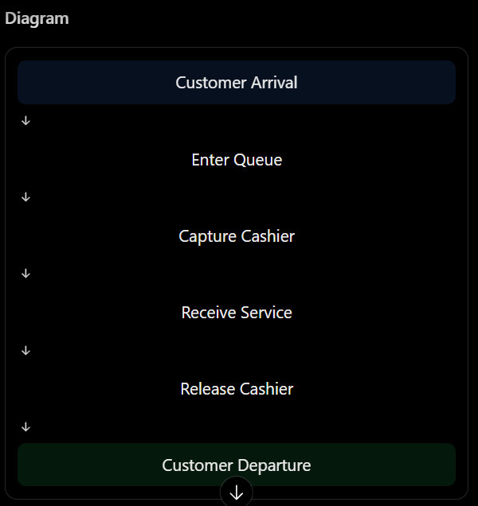

# **Module V – GPSS Action Times and Succession of Events**

These are two important topics in GPSS. Let's understand them separately with simple explanations and examples.

# **1. GPSS Action Times**

## **Definition**

**Action Time** is the amount of simulation time required to perform an activity or operation in a GPSS model.

In GPSS, different activities may take different amounts of time. The `ADVANCE` block is commonly used to represent the time taken by an activity.

**Example:** If a customer takes 5 minutes to receive service at a bank counter, the action time for that service is 5 minutes.

## **How Action Time Works in GPSS**

- When a transaction reaches an `ADVANCE` block, it is delayed for the specified time.
- During this delay, the transaction does not move to the next block.
- After the specified time is completed, the transaction becomes eligible to continue.

### **Example**

Suppose a customer requires 4 minutes for service.

```
GENERATE 5
SEIZE CASHIER
ADVANCE 4
RELEASE CASHIER
TERMINATE
```

**Explanation:**

| Statement       | Meaning                                       |
| --------------- | --------------------------------------------- |
| GENERATE 5      | Create customers at intervals of 5 time units |
| SEIZE CASHIER   | Capture the cashier                           |
| ADVANCE 4       | Spend 4 time units receiving service          |
| RELEASE CASHIER | Free the cashier                              |
| TERMINATE       | Remove the customer from the simulation       |

Here, the customer spends 4 simulation time units in the service activity.

## **Types of Action Time**

Action times can be represented in different ways:

**1. Constant Action Time**

- The activity always takes the same amount of time.
- Example: Every customer takes exactly 5 minutes for service.

**2. Variable Action Time**

- The activity takes different amounts of time.
- It may depend on a probability distribution.
- Example: Customers may take 2, 4, 5 or 7 minutes for service.

**3. Zero Action Time**

- Some activities do not require any simulation time.
- They happen immediately in the simulation.
- Example: Moving a transaction through a simple control block.

### **Importance of Action Time**

1. Helps represent real-world activity durations.
2. Helps calculate waiting and service times.
3. Makes simulation models more realistic.
4. Helps analyze system performance.

# **2. Succession of Events in GPSS**

## **Definition**

**Succession of Events** refers to the order in which different events occur during a simulation.

In GPSS, events are processed according to their scheduled simulation time. The simulation clock advances to the time of the next event.

**Example:** In a bank, a customer arrives, waits for the cashier, receives service and leaves. These activities occur in a particular sequence.

## **How Succession of Events Works**

Consider a bank with one cashier.

1. Customer arrives at the bank.
2. Customer enters the waiting queue if the cashier is busy.
3. Customer captures the cashier when it becomes available.
4. Customer receives service.
5. Customer releases the cashier.
6. Customer leaves the system.

### **Diagram**


## **Important Concepts in Succession of Events**

**1. Simulation Clock**

- It represents the current time in the simulation.
- It advances when the next scheduled event occurs.

**2. Event**

- An event is an activity that changes the state of a system.
- Example: Customer arrival or service completion.

**3. Event Scheduling**

- Events are scheduled to occur at particular simulation times.
- The next event is selected according to its scheduled time.

**4. Event Execution**

- The scheduled event is performed.
- The system state is updated, and new events may be scheduled.

### **Example of Event Sequence**

Suppose a customer arrives at time 0 and requires 4 minutes of service.

| Event                | Simulation time |
| -------------------- | --------------- |
| Customer arrives     | 0               |
| Service starts       | 0               |
| Service completes    | 4               |
| Cashier becomes free | 4               |
| Customer leaves      | 4               |

The simulation clock moves from 0 to 4 when the service completion event is reached.

## **Importance of Succession of Events**

1. Maintains the correct order of events.
2. Helps manage the simulation clock.
3. Helps model customer arrivals and departures.
4. Helps represent system behaviour accurately.
5. Makes discrete-event simulation possible.

# **3. Difference Between GPSS Action Times and Succession of Events**

| Basis        | Action Times                  | Succession of Events            |
| ------------ | ----------------------------- | ------------------------------- |
| Meaning      | Time required for an activity | Order in which events occur     |
| Focus        | Duration                      | Sequence                        |
| Main concept | How long an activity takes    | When an event occurs            |
| GPSS block   | ADVANCE                       | Event scheduling and processing |
| Example      | Service takes 4 minutes       | Arrival → Service → Departure   |

## **Quick Revision 📝**

**GPSS Action Times**

- Meaning: Duration of an activity.
- Important block: `ADVANCE`.
- Example: Service takes 5 minutes.

**Succession of Events**

- Meaning: Order of events.
- Important concept: Simulation clock and event scheduling.
- Example: Arrival → Queue → Service → Departure.

## **Important Exam Questions**

1. Define GPSS Action Time and explain its types with examples.
2. Explain the role of the ADVANCE block in GPSS.
3. What is Succession of Events? Explain with a suitable example.
4. Explain how events are scheduled and executed in GPSS.
5. Differentiate between Action Times and Succession of Events.

**Exam tip:** For Action Times, remember `ADVANCE` and activity duration. For Succession of Events, remember the simulation clock and the order of event execution.

**Next topic: Choice of Paths in GPSS.**