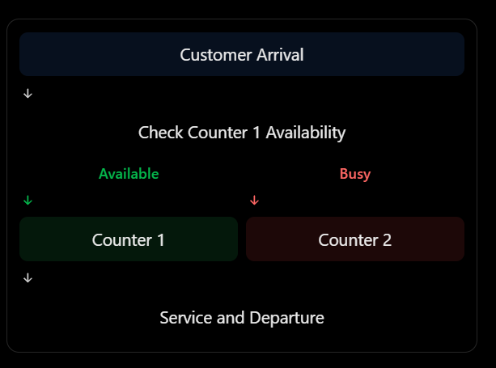

# **Module V – Conditional Transfers in GPSS**

## **1. Introduction**

In GPSS, transactions move from one block to another during simulation. Sometimes, a transaction needs to follow a different path depending on a particular condition.

**Conditional Transfer** is a mechanism in GPSS that allows transactions to move to different blocks based on specified conditions.

**Example:** In a bank, if Counter 1 is busy, a customer may be directed to Counter 2.

## **2. Types of Transfers in GPSS**

Conditional and unconditional transfers control the movement of transactions.

### **A. Unconditional Transfer**

- A transaction is transferred directly to another specified block.
- No condition is checked before transferring.
- It always follows the specified destination.

**Example:** Every customer is sent to the same service counter.

### **B. Conditional Transfer**

- A transaction is transferred depending on whether a specified condition is satisfied.
- Different destinations can be selected for different conditions.
- It is useful for decision-making in simulation models.

**Example:** If a machine is available, send the job to that machine; otherwise, send it to another machine.

## **3. TRANSFER Block in GPSS**

The `TRANSFER` block is used to control the movement of transactions from one block to another.

It supports different transfer modes, including conditional and unconditional transfers.

Common forms include:

| Form                   | Purpose                                            |
| ---------------------- | -------------------------------------------------- |
| Unconditional transfer | Transfers a transaction to a specified destination |
| Conditional transfer   | Transfers based on a condition                     |
| Statistical transfer   | Selects a destination using probability            |

The exact transfer mode and syntax depend on the GPSS version.

## **4. Example of Conditional Transfer**

Consider a bank with two counters.

- If Counter 1 is available, the customer goes to Counter 1.
- If Counter 1 is busy, the customer goes to Counter 2.

## **5. Advantages of Conditional Transfers**

1. **Flexible Routing:** Transactions can follow different paths.
2. **Decision Making:** Allows the model to make decisions based on conditions.
3. **Resource Utilization:** Helps distribute work among available resources.
4. **Realistic Simulation:** Represents real-world situations more accurately.
5. **Better Control:** Provides control over transaction movement.

## **6. Applications**

- Selecting available machines in manufacturing.
- Directing customers to different service counters.
- Routing packets through different network paths.
- Assigning jobs to available processors.
- Managing different paths in traffic simulations.

## **7. Conclusion**

Conditional Transfers in GPSS are used to control the movement of transactions based on specified conditions. They make simulation models flexible and help represent decision-making situations in real-world systems.

## **Quick Revision – Hinglish Summary**

- **Conditional Transfer:** Condition check karke transaction ko different block par bhejna.
- **Unconditional Transfer:** Bina condition check kiye transaction ko next destination par bhejna.
- **TRANSFER block:** Transaction ka route control karta hai.
- **Example:** Counter 1 free hai toh wahan bhejo, busy hai toh Counter 2 par bhejo.

**Remember:** Conditional Transfer = Condition checking + Different paths.