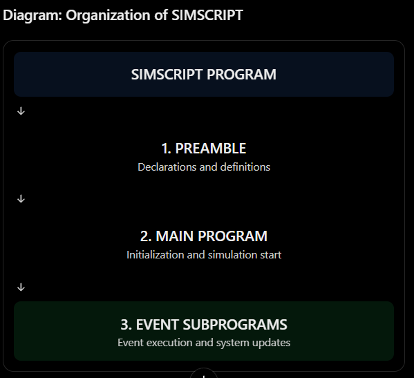

# **Module V – SIMSCRIPT: Organization and Program**

Important exam topic

## **1. What is SIMSCRIPT?**

**SIMSCRIPT** is a general-purpose simulation programming language used to develop and execute computer simulation models.

It is mainly used for discrete-event simulation and supports the modelling of entities, events, processes and resources.

**Example:** SIMSCRIPT can be used to simulate a bank where customers arrive, wait for service and leave.

## **2. Organization of a SIMSCRIPT Program**

A SIMSCRIPT program mainly consists of **three important parts**:

1. Preamble
2. Main Program
3. Event Subprograms

### **A. Preamble**

- The preamble is the declaration section of a SIMSCRIPT program.
- It defines the elements required for the simulation, such as entities, variables, attributes, resources and events.
- It does not contain executable statements.

**Example:** Defining customers, bank counters and service-time variables.

### **B. Main Program**

- The main program is the starting point of program execution.
- It initializes variables and resources.
- It schedules initial events and starts the simulation.

**Example:** Creating a bank counter and initializing the simulation clock.

### **C. Event Subprograms**

- Event subprograms define the actions performed when particular events occur.
- They update the system state and schedule future events.
- They control the behaviour of the simulation.

**Example:** Processing a customer arrival or completing customer service.

### **Diagram: Organization of SIMSCRIPT**



**Hinglish Summary:**

- Preamble = Variables aur simulation elements define karna.
- Main = Program ko initialize aur start karna.
- Event Subprograms = Events hone par kya action perform hoga, ye define karna.

## **3. Important Elements of SIMSCRIPT**

SIMSCRIPT uses the following elements to represent a system:

**1. Entities**

Entities represent objects in a simulation.

There are two types:

- **Permanent Entities:** Objects that exist throughout the simulation, such as a bank counter.
- **Temporary Entities:** Objects that enter and leave the system, such as customers.

**2. Attributes**

Attributes represent the properties of entities.

Example: A customer may have attributes such as arrival time and service time.

**3. Sets**

Sets are used to group and organize related entities.

Example: A set containing all customers waiting for service.

**4. Events**

Events represent activities that change the state of a system.

Example: Customer arrival and service completion.

**Hinglish Summary:** Entity = Object, Attribute = Uski property, Set = Objects ka group, Event = System mein hone wali activity.

## **4. Structure of a SIMSCRIPT Program**

A simple SIMSCRIPT II.5 program follows this general structure:

```
PREAMBLE
    Declarations
END

MAIN
    Initialization
    Simulation statements
END

EVENT ROUTINE
    Event processing statements
END
```

**Explanation:**

- PREAMBLE defines the required variables and simulation elements.
- MAIN initializes and starts the simulation.
- EVENT ROUTINE handles the events occurring during simulation.
- END marks the completion of each program section.

Note: This is a simplified structural representation. Actual SIMSCRIPT II.5 syntax has specific rules for declaring and defining routines.&#x20;

[image](https://www.google.com/s2/favicons?domain=https://www3.cs.stonybrook.edu\&sz=32)

www3.cs.stonybrook.edu+1


## **5. Advantages of SIMSCRIPT**

1. Easy-to-understand English-like programming structure.
2. Supports discrete-event simulation.
3. Can model complex real-world systems.
4. Supports entities, attributes, sets and events.
5. Helps analyze system behaviour and performance.

## **6. Applications of SIMSCRIPT**

- Banking and queuing systems.
- Computer networks.
- Manufacturing industries.
- Transportation systems.
- Military and defence simulations.
- Communication systems.

## **7. Conclusion**

SIMSCRIPT is a general-purpose simulation language used to model complex real-world systems. Its program organization consists of a preamble, main program and event subprograms. These components help define, initialize and execute simulation models efficiently.

## **Important Exam Questions**

### **Q1. Explain the organization of a SIMSCRIPT program.**

**Answer:** A SIMSCRIPT program consists of three main parts:

1. Preamble – Defines variables and simulation elements.
2. Main Program – Initializes the system and starts simulation.
3. Event Subprograms – Define and execute simulation events.

### **Q2. Explain the three main components of SIMSCRIPT.**

**Answer:** The three components are Preamble, Main Program and Event Subprograms. The preamble defines the model, the main program initializes it, and event subprograms control the activities occurring during simulation.

### **Q3. Explain entities, attributes, sets and events in SIMSCRIPT.**

**Answer:**

- Entities represent objects.
- Attributes represent properties of objects.
- Sets organize related entities.
- Events represent activities that change the system state.

## **Quick Revision 📝**

| Topic            | Remember                            |
| ---------------- | ----------------------------------- |
| SIMSCRIPT        | Simulation programming language     |
| Preamble         | Declaration section                 |
| Main             | Starting and initialization section |
| Event Subprogram | Handles events                      |
| Entity           | Object                              |
| Attribute        | Property                            |
| Set              | Group of entities                   |
| Event            | Activity that changes system state  |

Study priority: High

**Exam tip:** The organization diagram is especially useful. Remember the sequence:

**PREAMBLE → MAIN PROGRAM → EVENT SUBPROGRAMS**

Next topic: **SIMSCRIPT Names and Labels.**